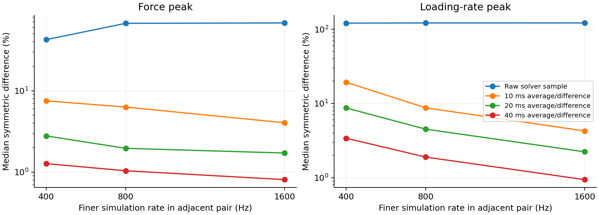
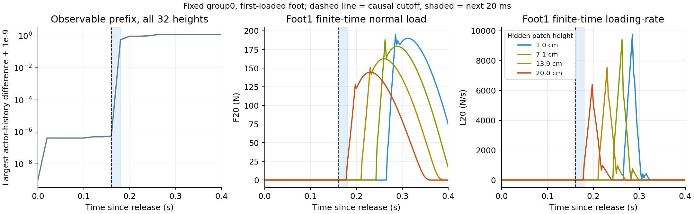
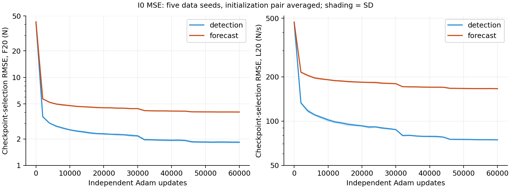
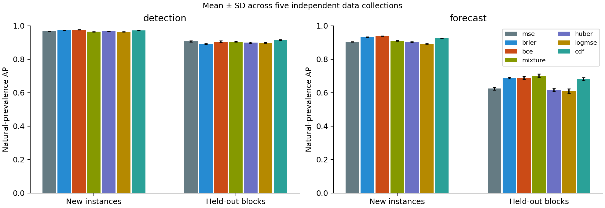
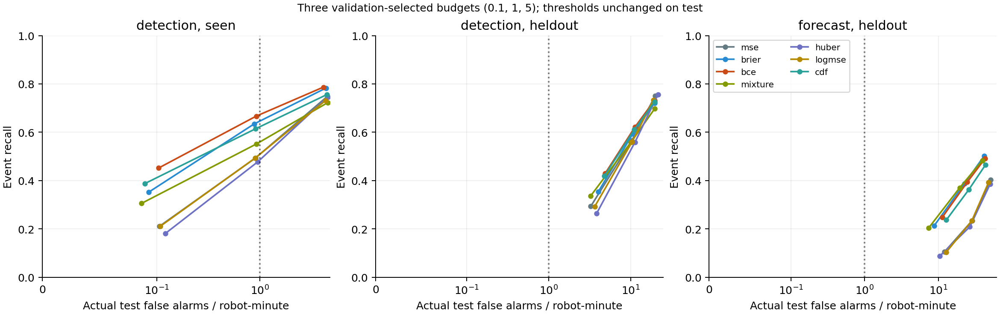
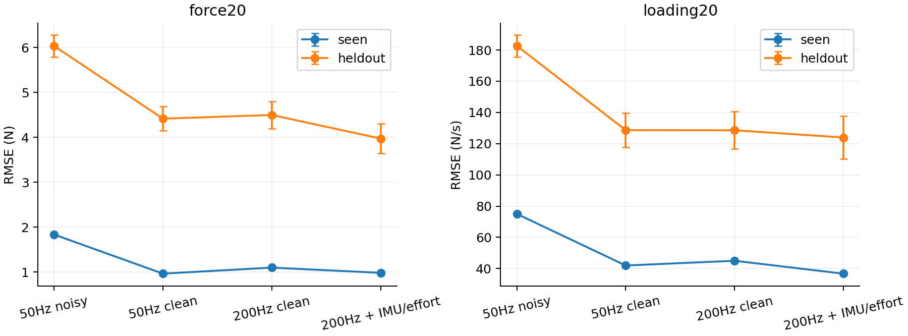

# Go1 接触力、loading-rate 与冲击风险：执行记录和阶段结论

完成日期：2026-11-04（Asia/Shanghai）。4096 env、5 组独立数据、780 个模型全部训练与测试完成。

**阶段结论：MSE 能低误差估计本轮 20 ms 时间尺度的当前接触载荷和 loading-rate；直接事件监督在特定报警用途上有明确收益，但不能概括为平方损失不适合冲击，也没有实现跨地形固定误报预算的可靠预警。** 同类别新实例中，当前 F20/L20 的 MSE RMSE 为 1.84 N / 74.97 N/s；训练排除的随机块上为 6.04 N / 182.61 N/s。二值 MSE 的本域 D 报警召回比连续幅值 MSE 高 14.08 个百分点，且两者满足本轮 FAR 区间标准；预设 BCE 主比较则因 FAR 上区间略超过预算未通过完整验收。

本轮同时比较连续 MSE、二值 MSE、BCE、混合分布、Huber、log-MSE、多阈值 CDF。没有找到一种方法在数值精度、风险排序和跨地形报警率上全面最优。Replay、持续学习漂移和在线适应仍是下一阶段假设，不能由当前静态分布外误差代替验证。

本轮独立于 learned admittance、静音步态、PPO 更新和 Replay。实验分支为 `feat/go1-impact-replay`，使用 `himloco_lab` 环境和冻结的 HIMLoco-Go1 PD 策略。

实际依赖为 Isaac Sim `6.1.0.0`、IsaacLab 源码 tag `v3.0.0-EA` / commit `ae37b028ea415c91ea2bc32609efcd759ed2b974`、PyTorch `2.11.0+cu128`。IsaacLab 的安装包 metadata 另报 `17.0.2`，这里同时记录包标识与项目 tag，复现以源码 commit 为准，见 [环境记录](../artifacts/impact/force_study_v1/environment.json)。

## 1. 本轮究竟检验什么

把三个问题分开：

1. 给定明确的传感输入和截止时刻，连续 MSE 对接触力幅值、loading-rate 能达到什么数值精度？
2. 目标变成强冲击事件时，连续条件均值是否足以支持报警？分类优势来自目标，还是 BCE 相对 MSE 的损失形式？
3. 直接学习条件分布或多阈值超越概率，能否保留事件所需的信息？

本轮“接触力”特指足端接触传感器**法向合力向量的模长**，不是完整三维含摩擦地面反力，也不是硬件力传感器真值。多接触点法向向量先由传感器汇总，再取模长。

设物理步长为 \(\delta\)，窗口 \(b=20\,\mathrm{ms}\)：

\[
F_b(t)=\frac{1}{b/\delta}\sum_{j=0}^{b/\delta-1}F(t-j\delta),\qquad
L_b(t)=\left[\frac{F_b(t)-F_b(t-b)}{b}\right]_+.
\]

主要连续目标是策略区间末端的 \(F_{20}\)（N）与 \(L_{20}\)（N/s）。主要冲击目标 \(S_{20}\) 是刚完成的 20 ms 区间内 \(L_{20}\) 的最大值，事件标签为 \(S_{20}>2000\,\mathrm{N/s}\)。它不等于瞬时 \(dF/dt\)。

- **D / detection**：使用区间结束时的六帧本体感觉，识别刚完成区间的冲击。
- **P20 / forecast**：使用区间开始时的六帧本体感觉，预测即将发生的 20 ms 区间。
- P20 包含已经接触情况下的后续载荷变化；不能把它统称为“严格首次接触前预测”。

P20 的 L20/S20 目标也包含截止时刻之前的滤波历史，因此有一部分信息已经存在；F20 则是下一 20 ms 区间的平均载荷，完全位于该预测区间。它们都不等于在未知地形首次碰撞前逐次精确预测原生力峰。

D 的高分表示区间结束后的识别能力，不能补救已经过去的首次冲击峰。P20 表示下一 20 ms 区间的目标，不保证对其中每次冲击都有完整 20 ms 提前量；当前也未计入真实设备上的推理和通信时延。

10 ms 指标、原生物理步上的接触力和差分峰值是诊断项。不同滤波窗口对应不同目标，不能只比较 AP 就说物理量更准确。

具体地，`force_raw` 是区间末端那一个原生力样本，**不是整个区间的原生力峰**；`rate_raw` 才是该区间的原生正向单步差分峰。`force10/loading10/impact10` 是对应的 10 ms 版本。物理诊断的峰值比较与模型端点预测有不同采样定义，不能混为一种精度。

原始采集仍保留旧版 10 ms 标签，其 `window.rise_interval_s=0.01` 描述的是这些旧字段。本轮 10/20 ms 目标由原生接触轨迹重新构造，训练读取新 cache 的八个目标，不读取旧的预计算 `positive_rate_fixed_window` 字段。

## 2. 实际执行协议

设置由 [配置](../configs/impact/force_study_v1.json)、[研究方案](GO1_FORCE_LOADING_RATE_RESEARCH_PLAN.md)、[测试前快照](../artifacts/impact/force_study_v1/pre_test_snapshot.json) 和 [指标补充记录](../artifacts/impact/force_study_v1/pre_test_metric_addendum.json) 记录。这是本地测试前固定的协议，没有声称完成外部公开预注册。

| 项目 | 实际设置 |
|---|---|
| 冻结策略 | `model_10000.pt` 对应的已部署 JIT policy；Kp=40、Kd=1、action scale=0.25 |
| 新研究物理频率 | 400 Hz；策略仍为 50 Hz；原 baseline 的 200 Hz 配置未改 |
| 并行环境 | 每次采集 4096 |
| 独立数据重复 | 5；训练 411–415，验证 511–515，测试 611–615 |
| 每次数据量 | train 2500、validation 600、test 600 个策略步 |
| 原始样本合计 | 75,776,000 个机器人策略区间；每个区间四足标签相关 |
| 运动条件 | 固定指令 (0.7, 0, 0)，6 s episode；受控初始状态扰动 |
| 地形 | 平面、粗糙、上下坡、上下阶梯；随机块状地形仅作 held-out |
| 地形尺寸和相关性 | 每次采集 84 个 12×12 m 地形块，4096 个机器人共享；不能把机器人当成独立几何重复 |
| 地形范围 | 粗糙高度 1–4 cm；坡度参数 0.05–0.25；阶梯和随机块高度 2–10 cm |
| 主方法 | 连续 MSE、二值 MSE/Brier、BCE、3 分量 hurdle-lognormal 混合分布 |
| 次级方法 | Huber、log-MSE、9 阈值单调超越概率 CDF；在查看新测试集前固定 |
| 训练 | 每个方法、目标、初始化为独立网络；2 次配对初始化；60,000 次 Adam 更新，batch=2048 |
| 优化选择 | 旧 Step1 开发数据上 6 组 lr/weight-decay；正式验证集按各自目标选择 checkpoint |
| 验证职责 | 按 env index mod 4 分为 checkpoint、概率校准、报警阈值选择、独立报警验证 |
| 模型比较顺序 | 所有模型完成训练后，才开启最终测试集评价；测试结果不驱动重训练 |
| 报警预算 | 每机器人分钟 0.1、1、5 次误报；主预算 1 次 |

验证职责之间共享部分地形几何，因此独立报警验证是不同轨迹的验证；最终测试使用独立生成的几何。held-out 随机块不参与训练、checkpoint 选择、概率校准或报警阈值选择。没有在此轮加入摩擦、质量、外推速度和推扰的组合泛化。

每次 reset 后固定排除前 25 个策略区间（500 ms），用于历史填充和初始过渡；后续有效终止区间保留，不能把结果外推到被排除的初始落地。坡、阶梯和随机块具有 1.5 m 起始平台，主要指标包含机器人经过平台和进入地形的自然轨迹，不能解释为纯障碍接触子集。随机块这一地形类别在旧 Step1 已经出现过；本轮是训练完全排除该类别、测试采用新几何实例，并非研究者从未见过该类别的盲测。

主要 I0 输入为带 baseline 噪声的 45×6=270 维历史，没有显式 IMU 线加速度或实测关节扭矩。连续目标还使用了输入阶梯：

| 输入 | 信息 | 配平方式 |
|---|---|---|
| I0 | 50 Hz、有噪声、六帧本体感觉 | hidden 128/64 |
| I0clean | 对齐相同时刻的无噪声六帧 | hidden 128/64 |
| I1 | 200 Hz、无噪声、21 帧，相同约 100 ms 历史跨度 | hidden 42/64 |
| I2 | I1 加理想机身 specific force 和实际施加的 12 维关节扭矩 | hidden 32/64 |

各网络约 4.5 万分配参数，连续标量头约 4.3 万有效参数。高频输入的第一隐藏层更窄，且沿用 I0 的开发超参数；这是控制容量的诊断，不是每种传感组合的最优可达精度。I2 是理想仿真传感条件，未验证硬件带宽、噪声、偏置、饱和及扭矩测量误差；也不能单独归因于 IMU 或扭矩。

开发 HPO 在旧 Step1 的 D 任务上执行，P20 和输入消融沿用相应方法/目标的选择，没有分别搜索每种输入和时间截止的最优超参数。这是同等既定预算下的比较，不是对各方法最优性能的穷尽搜索。

混合分布以 NLL 训练，输出零点质量及三个 lognormal 分量。其导出点值使用分量指数上限 `exp(min(mu + sigma²/2, 10))` 防止数值溢出，因此在触及上限时不是未截断分布的严格数学均值。NLL、尾部概率和该点值是不同评价对象；不能把点值失败一概解释为 MSE 失败，也不能把风险分数优于这个点值写成纯粹隔离了条件均值信息压缩的证明。

无加性噪声的高频观测以 float16 缓存，逐通道最大量化误差记录在每份 cache metadata；“clean”不表示无限数值精度。I0 保留原始 float32 带噪声观测。

事件按同足连续真值区间分组，允许合并两步间隔；报警是因果向上越阈，过去五步内有原始越阈则抑制。重复报警计误报，同足一对一匹配，无额外放宽的未来匹配容差。阈值只在验证轨迹选择，测试时固定。概率校准独立于原始排序分数，避免 isotonic 并列值改变可实现的报警排序。

统计先平均同一份数据上的两个初始化，再对 **5 个独立采集 seed** 给出配对 t 区间；不会把它写成 10 次独立数据实验。误报率另对数据重复与其内部地形块分层 bootstrap。预先设定有意义召回增益 0.03、AP 等价边界 ±0.01、召回等价边界 ±0.03；不显著不等于等价。

区间均为逐项 95% 区间，没有对大量诊断项作多重比较校正。主目标与主比较优先解释，次级方法和分地形结果用于后续研究，不以其中最好的单项宣称普遍最优。

## 3. 先验证监督目标：物理步长与 solver

128 个配对 Go1 初始状态、固定零策略动作落地（PD 仍以 Kp=40、Kd=1 追踪名义关节角），改变物理步长；每足首次超过 1 N 后 60 ms 内取峰值。比较同时改变了积分、接触求解和实际轨迹，不能称为只改变采样率。下表是中位对称相对差异 \( |a-b|/((|a|+|b|)/2) \)。

| 相邻频率 | 原生力峰 | 原生正向差分峰 | F20 峰 | L20 峰 |
|---|---:|---:|---:|---:|
| 200→400 Hz | 42.48% | 120.77% | 2.79% | 8.70% |
| 400→800 Hz | 67.36% | 121.42% | 1.97% | 4.51% |
| 800→1600 Hz | 68.15% | 121.49% | 1.72% | 2.24% |

在 400 Hz 下将**实际全局及 articulation solver 约束**从 position/velocity=4/0 改为 8/4，原生力峰/差分峰变化 12.32%/13.84%，F20/L20 仅 0.53%/0.86%。800 Hz 对应 F20/L20 为 0.32%/0.41%。首次仅更改 articulation 的请求被全局上限钳制，相关旧记录保留作实现诊断，已经排除，不能拿其零差异作为 solver 稳健证据。

更直接的配对峰值比：400→800 Hz 的原生力峰中位比值 2.016、差分峰 4.090；800→1600 Hz 为 2.034、4.095。这与 \(F\sim J/\delta\)、单步变化率 \(\sim J/\delta^2\) 的离散冲量表现一致，是对本组结果的机制解释，不是对所有软接触、所有模拟器的普遍发散证明。

这支持本轮选用 400 Hz 仿真和有限时间尺度目标，**不支持把刚性接触原生差分峰当成已经验证的硬件 loading-rate 真值**。更长窗口更稳定，也会损失短时峰值和增加时延；20 ms 不是通用最优窗口。部分阈值在落地数据上全为正，标签一致率必须结合阳性率看，不能据此证明分类稳健。

固定步长下，MSE 仍可能拟合这种原生数值量；拟合得好不等于物理量定义稳定。对同一个步长敏感的量做分类也不会自动修复标签，甚至可能因所有样本超阈而产生虚假的稳定性。



原始诊断：[physics.json](../artifacts/impact/force_study_v1/physics.json)。PhysX 文档也说明离散报告的力涉及步内平均，并提醒峰值会依赖时间步长：[官方 articulation 文档](https://nvidia-omniverse.github.io/PhysX/physx/5.6.1/docs/Articulations.html)、[contact impulse API](https://nvidia-omniverse.github.io/PhysX/physx/5.6.1/_api_build/structPxContactPairPoint.html)。文档不是本轮传感器接口的替代验证，实际证据来自上面的配对试验。

## 4. 隐藏地形分支：可预测性不是单纯的损失问题

独立机制实验使用 4096 个 Go1，128 组相同本体初始状态，每组 32 个隐藏承接面高度，固定零策略动作且保留名义角 PD。截取各组首次足端载荷超过 1 N 所在策略区间之前的共同前缀，比较未来 20/200 ms 的 L20 峰值。

原始浮点观测前缀最大差异为 `2.56e-5`，没有严格相同的原始浮点输入。因此不声称“原始 I0 精确同输入必有不同输出”的无条件数值下界。将观测显式量化到 1e-3 后，4095/4096 分支进入重复输入桶，20 ms 目标的桶内 MSE 下界约 `9.31e5 (N/s)^2`；这是量化传感模型的结论。

另在匹配 baseline 噪声幅度的**独立连续均匀测量噪声模型**下，采用固定镜像高度配对。把 pair ID 额外揭示给理想估计器，已知两条分支噪声盒的重叠比例 \(\gamma\)，交叠部分后验各 1/2，则其均方误差为 \(\gamma(y_a-y_b)^2/4\)。额外知道 pair ID 只能降低误差，因此平均配对误差给出完整 32 分支问题的下界。

- 完整配置噪声下，平均噪声支持交叠比例约 0.99987。
- 未来 20 ms 幅值的 MSE 下界约 `5.50e5 (N/s)^2`，对应 RMS 约 **742 N/s**；事件 Brier 下界约 **0.0278**。
- 未来 200 ms 的幅值 RMS 下界约 **966 N/s**，但此构造中所有事件标签同为正，Brier 下界为零。这只是说明粗化目标可降低信息需求，不是一个有实用价值的“分类准确率 100%”结果。

这些下界依赖明确的统计噪声模型和本机制实验的分支先验；不是有限精度 PRNG 的严格支持结论，不是正常行走数据的误差下界，也不是当前接触识别 D 的误差下界。首次 >1 N 之前不等于经过几何间隙验证的严格无接触。

因此，正常行走预测的 RMSE 小于上述 742 N/s，并不与机制实验矛盾；两者的数据分布和条件信息不同。

下图固定使用 group0，足按该组最早建立载荷的规则选取，四条曲线固定为分支 0/10/21/31；用于说明机制，不用于选择模型或计算优势。



机制上可以确认：未来幅值不确定时，回归条件均值并未违反因果律；当不同未来跨过分类阈值，分类也存在不可消除的不确定性。原始记录：[paired_branches.json](../artifacts/impact/force_study_v1/paired_branches.json)。

## 5. 正式模型比较：全部完成

全部 35 个任务运行、780 个独立模型实例完成，每模型 60,000 次 Adam 更新、batch=2048。两个初始化先平均，再对五个独立数据重复统计。有效训练样本唯一访问比例最低为 99.99995%。最终测试包含约 3754.66 机器人分钟；四足不是四倍独立暴露。

### 5.1 连续 MSE 能学到什么精度

下表为测试误差均值，数值输出按预定规则投影至非负值。完整逐次数据、95% 区间、原始未投影输出与容差曲线见 [summary.json](../artifacts/impact/force_study_v1/summary.json) / [metrics.csv](../artifacts/impact/force_study_v1/metrics.csv)。

| 任务 | 测试域 | F20 MAE (N) | F20 RMSE (N) | L20 MAE (N/s) | L20 RMSE (N/s) |
|---|---|---|---|---|---|
| D：区间结束后识别 | 已训练类别的新实例 | 0.84 | 1.84 | 24.08 | 74.97 |
| D：区间结束后识别 | 训练排除的随机块 | 1.99 | 6.04 | 50.47 | 182.61 |
| P20：提前一个区间 | 已训练类别的新实例 | 1.83 | 4.02 | 57.67 | 165.73 |
| P20：提前一个区间 | 训练排除的随机块 | 5.04 | 11.94 | 149.71 | 455.94 |

训练集各足均值作为常数预测时，同类别测试 F20 / L20 RMSE 为 33.71 N / 491.90 N/s；全零预测为 46.71 N / 534.76 N/s。MSE 的明显改善不能解释成仅输出零或均值。不过这仍是固定速度、策略和传感配置下的有限窗口模拟量精度。

D 同类别测试中，F20 误差 ≤2 N / ≤5 N 的比例为 89.17% / 98.56%；随机块为 78.08% / 92.14%。L20 误差 ≤100 N/s 的比例为 94.16% / 89.04%。不预设下游控制容差，因此不把这些数字写成普遍“精确足够”。

| 目标 | 任务 | 测试域 | 超事件阈值子集 MAE | 该子集绝对误差 p95 | 单位 |
|---|---|---|---|---|---|
| force20 | D | seen | 1.11 | 2.82 | N |
| force20 | D | heldout | 2.47 | 8.14 | N |
| force20 | P20 | seen | 1.91 | 4.99 | N |
| force20 | P20 | heldout | 5.17 | 19.77 | N |
| loading20 | D | seen | 185.25 | 557.48 | N/s |
| loading20 | D | heldout | 387.11 | 1460.24 | N/s |
| loading20 | P20 | seen | 470.92 | 1577.80 | N/s |
| loading20 | P20 | heldout | 1172.51 | 3370.55 | N/s |

强载荷/强 loading-rate 尾部明显比整体均值困难，特别是 P20 的 held-out L20。整体 MAE 小、事件 AP 高和尾部数值精确，是三个不同结论。

最后 10,000 步，同类别验证 MSE 的平均相对改善：D 的 F20/L20/S20 为 0.86%/1.27%/1.21%；P20 为 0.46%/0.68%/0.63%。曲线已趋缓，但不能据此宣称所有架构都达到信息论极限。图中是 checkpoint 选择验证集，并非最终测试。



### 5.2 小载荷与原生差分诊断

| D 子集 | 测试域 | 非负输出 MAE | 目标中位数 | 输出中位数 | 原始输出负值比例 | 非负输出近零比例 |
|---|---|---|---|---|---|---|
| 1 < F20 < 10 N | seen | 1.92 | 5.62 | 5.08 | 2.23% | 11.79% |
| 1 < F20 < 10 N | heldout | 3.23 | 5.61 | 4.45 | 6.03% | 19.84% |
| 100 < L20 < 500 N/s | seen | 48.72 | 283.61 | 275.95 | 0.43% | 7.37% |
| 100 < L20 < 500 N/s | heldout | 75.57 | 283.83 | 268.84 | 1.94% | 11.78% |

小载荷没有普遍坍缩为零；跨地形仍有负值、近零和幅值误差。这里的非负幅值不能替代 UniFP 中有符号三维力方向的验证。表中近零分别定义为 ≤1 N、≤100 N/s，原始负值与投影后近零不是同一统计。

| D 诊断目标 | seen RMSE | held-out RMSE | 单位 |
|---|---|---|---|
| force_raw | 2.95 | 8.08 | N |
| force10 | 2.15 | 6.77 | N |
| force20 | 1.84 | 6.04 | N |
| rate_raw | 1742.72 | 4233.12 | N/s |
| loading10 | 187.13 | 376.95 | N/s |
| loading20 | 74.97 | 182.61 | N/s |

不同窗口不是同一个目标。原生力这里是区间末端样本，原生 rate 是区间内单步正向差分峰；其固定 dt 拟合结果不能推翻第 3 节的物理步长敏感性。

### 5.3 事件监督、损失形式与报警用途

以下统一评价 S20 > 2000 N/s 的自然频率 AP，显示五个数据重复的均值 ± SD。D/P20 的输入截止不同。

| 方法 | D seen | D held-out | P20 seen | P20 held-out |
|---|---|---|---|---|
| 连续 MSE | 0.9672 ± 0.0005 | 0.9063 ± 0.0033 | 0.9043 ± 0.0011 | 0.6243 ± 0.0084 |
| 二值 MSE / Brier | 0.9731 ± 0.0006 | 0.8913 ± 0.0031 | 0.9320 ± 0.0012 | 0.6878 ± 0.0042 |
| BCE | 0.9764 ± 0.0004 | 0.9050 ± 0.0057 | 0.9384 ± 0.0007 | 0.6881 ± 0.0094 |
| hurdle-lognormal mixture | 0.9645 ± 0.0010 | 0.9044 ± 0.0024 | 0.9105 ± 0.0016 | 0.7017 ± 0.0096 |
| Huber + 非负头 | 0.9668 ± 0.0005 | 0.8990 ± 0.0044 | 0.9032 ± 0.0014 | 0.6158 ± 0.0099 |
| log-MSE | 0.9632 ± 0.0007 | 0.8982 ± 0.0035 | 0.8917 ± 0.0017 | 0.6091 ± 0.0134 |
| 9 阈值单调 CDF | 0.9726 ± 0.0004 | 0.9145 ± 0.0032 | 0.9251 ± 0.0010 | 0.6817 ± 0.0088 |



连续 MSE → 二值 MSE 保持平方损失，却改为学习事件概率。P20 上两种事件监督都优于连续幅值 MSE：

| 任务 | 测试域 | 配对比较 | AP 差值 [95% CI] |
|---|---|---|---|
| detection | seen | 二值 MSE / Brier − 连续 MSE | 0.0060 [0.0054, 0.0065] |
| detection | seen | BCE − 连续 MSE | 0.0092 [0.0088, 0.0096] |
| detection | heldout | 二值 MSE / Brier − 连续 MSE | -0.0151 [-0.0200, -0.0101] |
| detection | heldout | BCE − 连续 MSE | -0.0013 [-0.0067, 0.0041] |
| forecast | seen | 二值 MSE / Brier − 连续 MSE | 0.0277 [0.0275, 0.0279] |
| forecast | seen | BCE − 连续 MSE | 0.0341 [0.0333, 0.0349] |
| forecast | heldout | 二值 MSE / Brier − 连续 MSE | 0.0636 [0.0522, 0.0750] |
| forecast | heldout | BCE − 连续 MSE | 0.0639 [0.0434, 0.0843] |

D held-out 的 BCE 与连续 MSE 的 AP 差值区间位于预定 ±0.01 内；二值 MSE 的 AP 反而较差。不能概括为所有分类方法普遍优于回归。D seen 的 BCE−连续 MSE AP 差异也小于预定 0.01 边界，但下面的低误报事件召回差异很大。

下面固定使用验证集选择的“1 次/机器人分钟”工作点，测试时不调整阈值。FAR 区间为按数据重复和类别内地形块分层 bootstrap 的 95% 区间；召回率按数据重复平均。

**D：区间结束后识别**

| 方法 | seen 召回 | seen 实测 FAR [95% CI] | held-out 召回 | held-out 实测 FAR [95% CI] |
|---|---|---|---|---|
| 连续 MSE | 49.37% | 0.912 [0.843, 0.990] | 56.55% | 10.295 [8.828, 11.866] |
| 二值 MSE / Brier | 63.44% | 0.884 [0.808, 0.986] | 59.45% | 10.624 [9.317, 11.957] |
| BCE | 66.67% | 0.926 [0.855, 1.002] | 62.20% | 11.268 [9.814, 12.829] |
| hurdle-lognormal mixture | 55.14% | 0.929 [0.884, 0.976] | 55.79% | 10.007 [8.698, 11.385] |
| Huber + 非负头 | 47.68% | 0.954 [0.870, 1.042] | 55.88% | 11.251 [9.717, 12.819] |
| log-MSE | 49.26% | 0.900 [0.836, 0.967] | 56.01% | 10.362 [8.795, 12.035] |
| 9 阈值单调 CDF | 61.47% | 0.916 [0.858, 0.984] | 61.12% | 11.045 [9.462, 12.585] |

**P20：提前一个区间**

| 方法 | seen 召回 | seen 实测 FAR [95% CI] | held-out 召回 | held-out 实测 FAR [95% CI] |
|---|---|---|---|---|
| 连续 MSE | 23.71% | 1.006 [0.890, 1.138] | 23.44% | 28.703 [23.287, 34.352] |
| 二值 MSE / Brier | 47.47% | 0.931 [0.851, 1.009] | 38.69% | 22.508 [19.011, 26.083] |
| BCE | 51.18% | 0.915 [0.797, 1.046] | 39.39% | 24.661 [20.615, 28.913] |
| hurdle-lognormal mixture | 40.70% | 0.875 [0.804, 0.951] | 37.03% | 19.453 [15.793, 23.406] |
| Huber + 非负头 | 20.21% | 0.941 [0.809, 1.094] | 20.89% | 26.732 [21.092, 32.582] |
| log-MSE | 24.22% | 0.981 [0.856, 1.133] | 23.35% | 28.394 [22.619, 34.619] |
| 9 阈值单调 CDF | 42.74% | 0.920 [0.824, 1.019] | 36.21% | 25.814 [20.861, 31.040] |

D seen 中二值 MSE 比连续幅值 MSE 的配对召回增益为 **14.08 个百分点 [11.80, 16.35]**，超过预设 3 个百分点；两者 FAR 上区间均 <1。这是本轮明确支持事件监督用途优势的一项证据。该比较属于预设二值平方损失对照，主比较 BCE 对验证所选回归方法需单独判断。

预设主比较为 BCE 对验证所选回归方法。D seen 的召回配对增益（百分点及 95% CI）为 11.5288 [10.3317, 12.7259]；本轮 D 的验证选择全部是 mixture。尽管召回增益超过 3 个百分点，BCE 的严格 FAR 条件未通过，因此主比较的完整工作点验收判为未通过。不能以另一个方法通过来改写这项结果。

BCE 的 D seen 召回为 66.67%，但 FAR 上区间为 **1.00165**，严格按本轮标准未通过 ≤1 验收，不能四舍五入成通过。P20 seen 的二值 MSE/BCE 上区间也超过预算。全部 held-out 结果存在显著阈值转移误报；更高召回不能包装成“保持相同实际误报率的优势”。完整 0.1/1/5 预算及独立验证角色见 summary.json。

这个 BCE 结果接近验收边界，区间本身还受五个数据重复及 bootstrap Monte Carlo 误差影响，不能解释成其不适合冲击。下一轮可在验证集以 FAR 置信上界而非仅经验均值选点，并预留统计裕量，再在新测试集复验；本轮保留原阈值和原判定。

二值 MSE 与 BCE 在部分 AP 比较上落入 ±0.01 等价区间，但 D seen 召回差异未通过 ±0.03 等价检验，P20 held-out AP 的区间也未完全落入 ±0.01。故不能宣称两种损失在所有用途上等价：事件监督目标有作用，有限训练下的优化差异也存在。分数时序形状与固定报警规则的交互同样包含在召回结果中。



### 5.4 输入信息与差分路径

| D 输入 | F20 seen RMSE (N) | F20 held-out RMSE (N) | L20 seen RMSE (N/s) | L20 held-out RMSE (N/s) |
|---|---|---|---|---|
| I0 | 1.84 | 6.04 | 74.97 | 182.61 |
| I0clean | 0.97 | 4.42 | 41.95 | 128.63 |
| I1 | 1.10 | 4.50 | 44.98 | 128.58 |
| I2 | 0.99 | 3.98 | 36.73 | 123.95 |

移除配置观测噪声明显改善数值精度。I1 虽增加时间分辨率，本域却弱于 I0clean；其首层变窄且没有独立 HPO，不能据此得出高频信息无用。I2 在理想仿真传感条件下改善部分指标，不能直接外推为真实 IMU/电流带来同样收益。



| 任务 | 测试域 | 直接预测 L20 RMSE (N/s) | F20 预测后差分 RMSE (N/s) |
|---|---|---|---|
| detection | seen | 75.03 | 81.13 |
| detection | heldout | 182.92 | 177.38 |
| forecast | seen | 165.85 | 209.19 |
| forecast | heldout | 456.74 | 431.16 |

这里使用同一 age≥26 子集，所以直接项与主表略有差别。**本域直接预测更好，held-out 则差分路径更好**；不能把误差传播上界或期望不交换当成直接预测总是更好的实证证明。差异还包含估计误差、时间截止和条件信息差别。

### 5.5 其他方法的连续数值表现

**detection**

| 方法 | F20 seen (N) | F20 held-out (N) | L20 seen (N/s) | L20 held-out (N/s) |
|---|---|---|---|---|
| 连续 MSE | 1.84 | 6.04 | 74.97 | 182.61 |
| Huber + 非负头 | 1.82 | 6.14 | 74.17 | 187.50 |
| log-MSE | 1.87 | 6.37 | 75.45 | 215.99 |
| hurdle-lognormal mixture | 84.18 | 787.84 | 3715.27 | 7.15e+04 |

**forecast**

| 方法 | F20 seen (N) | F20 held-out (N) | L20 seen (N/s) | L20 held-out (N/s) |
|---|---|---|---|---|
| 连续 MSE | 4.02 | 11.94 | 165.73 | 455.94 |
| Huber + 非负头 | 3.98 | 11.85 | 166.28 | 465.51 |
| log-MSE | 4.12 | 55.44 | 166.77 | 845.28 |
| hurdle-lognormal mixture | 447.36 | 5050.85 | 7246.33 | 9.16e+04 |

Huber 和 log-MSE 改变了优化目标；Huber 还使用非负参数化，因此不是纯损失单因素消融。log-MSE 导出的点值也不是原尺度条件均值。不得只挑其某个载荷段改善就称为全局最优。CDF 只输出多阈值概率，不参与数值误差比赛；当前评价主要阈值，不代表九个阈值都已完成校准验收。

混合分布出现严重的导出点值长尾不稳定，已原样保留。训练 NLL 较低或风险 AP 可用，并不保证有限样本下 lognormal 尾部的导出点值准确。指数保护上限的语义见第 2 节；此失败不是 MSE 训练失败，也不能作为所有分布预测方法不可用的证据。

| 同一个 mixture 模型 | 测试域 | 尾部风险 AP | 导出点值 AP |
|---|---|---|---|
| detection | seen | 0.9645 | 0.7649 |
| detection | heldout | 0.9044 | 0.6553 |
| forecast | seen | 0.9105 | 0.8057 |
| forecast | heldout | 0.7017 | 0.5242 |

这些实测值展示输出接口的差别，但不完全隔离“理想条件均值压缩”的影响，因为分布拟合及长尾导出本身也可能失败。所有模型都保持锁定，没有因测试结果修改尾部截断、训练损失或选取新 checkpoint。


### 5.6 其他方法带来的结论

Huber 在部分本域数值 RMSE 上略好于 MSE，但没有全面改善 held-out loading-rate。log-MSE 的本域平均值接近 MSE，在 P20 held-out 的 F20 / L20 上却退化至 55.44 N / 845.28 N/s，明显差于 MSE 的 11.94 N / 455.94 N/s；因此简单变换损失不能保证跨域稳定。

多阈值 CDF 的 D held-out AP 均值为 0.9145，高于 BCE 的 0.9050 和连续 MSE 的 0.9063；但其本域 D 召回 61.47% 低于二值 MSE/BCE，P20 AP 也未全面胜过单阈值事件头。它是值得保留的可解释严重度接口，不是已经证明全面更好的新算法。

混合分布的 P20 held-out 风险 AP 均值为 0.7017，是此项比较中的最高均值；其导出连续点值却很不稳定。这同时反对两个过度结论：“分类胜过所有连续/分布模型”以及“有了概率分布就一定能准确输出力值”。本轮不根据该测试集挑出一个通用冠军，也不在看过测试后收紧其尾部上限重算成绩。

下一步保留连续 MSE 作为数值参考，保留 BCE 与二值 MSE 作为事件监督参考，CDF 作为多阈值表示对照。若再研究混合分布，应在新的开发/测试划分上处理尾部约束与点预测目标，不能覆盖本轮失败记录。

## 6. 如何解释分类、MSE 与下游任务

**“从本体感觉预测未来违反因果律”应当修正。** 条件均值、条件分布和事件概率的统计预测都不违反因果律；问题是截止时刻的信息能否唯一确定单次未来结果。未知地形分支的机制实验显示，在明确噪声/量化模型下，确实可能存在不可消除的未来幅值误差；分类标签跨阈值变化时也会有不可消除的不确定性。

平方损失连续回归的总体最优解是 \(\mathbb E[Y\mid H]\)；对二值标签 \(Z=\mathbf1\{Y>u\}\) 使用平方损失，则最优解是 \(\mathbb P(Y>u\mid H)\)，与 BCE 所求的概率相同。二值 MSE 对照用于区分“预测目标”与“损失形式”，不是把连续回归改个名字。

例如阈值为 2000 N/s：一组未来为 0/6000，强冲击概率 0.2，条件均值 1200；另一组未来恒为 1200，强冲击概率为零，条件均值也是 1200。条件均值相同并不保证超阈值风险相同。因此对连续均值做标量阈值或单调校准，一般无法恢复全部风险信息。

这并不意味着分类总是更容易或更好。分类仍需要足够事件样本、概率校准、阈值稳定性和跨分布验证；阈值附近的不确定性可能很大。分布预测也可以输出同样的尾部概率，所以分类胜过点均值不等于分类胜过所有连续预测方法。

对本轮非负幅值，理论条件均值也非负。若无约束网络输出负值，那是有限模型、训练或外推的误差，不能说是 MSE 总体最优解必然产生负力；本轮同时保留原始输出和非负投影后的指标。三维有符号力分量还可能因为方向不确定而相互抵消，不能由此处幅值实验直接判断 UniFP 的方向预测问题。

“单独回归”与“下游需要回归”应区分：离线整体 MAE 小，不代表小载荷、强冲击尾部或反馈控制容差满足要求；报警事件的排序也不代表可用力值。数值预测需要按单位、时延、载荷分段和容差评价，最后再检验具体下游任务。没有下游控制容差时，本轮只报告误差与容差覆盖率，不给出通用“精确足够”的结论。

loading-rate 还有误差传播问题。对同一有限时间尺度和 ReLU 正向差分，若力值预测误差为 \(e_t\)，则

\[
|\hat L_b-L_b|\le (|e_t|+|e_{t-b}|)/b.
\]

在 20 ms 下，两端各 2 N 的误差可产生最高 200 N/s 的差分误差。另外，正向差分与条件期望通常不交换，不能把“预测均值力后差分”视为“直接预测均值 loading-rate”的等价实现。本轮同时报告二者，使用相同有效样本，并检查真值 F20 差分能够重构 L20。

可参考 [Gneiting 的点预测与损失分析](https://arxiv.org/abs/0912.0902)。已有 [本体感觉接触概率学习](https://arxiv.org/abs/2208.00278)、[包括 Go1 的惯性接触概率估计](https://arxiv.org/abs/2303.00538) 和 [本体感觉外力矩/接触 wrench 学习](https://arxiv.org/abs/2309.04138)；不能把“仿真监督 + 本体感觉分类”或“MSE 学外力”本身当作全新想法。

之前 wheel-leg/admittance 记录支持“当时整条回归控制方案表现不好”这个观察，但没有隔离出 MSE 的原因：早期存在 SmoothL1、未来目标与已完成区间目标的切换，以及抑制式门控与放大型控制律的切换。旧 Step1 中较好的 MSE 数字也对应接触完成后的有限窗口指标，不能用来反驳“严格提前预测单次峰值困难”。本轮正是把时间截止、连续精度和事件决策拆开，避免重复这种比较混杂。

## 7. 完整性、限制与复现

新记录器的 64 env、40 步、强制 reset 开关对照中，共同原始字段逐项相同，包括动作、观测、接触轨迹和终止标记；两个版本均捕获 64 次终止区间。15 份正式采集的历史重建、接触传感器对照和历史重叠误差全部为零。详见 [记录器对照](../artifacts/impact/force_study_v1/observer_noninterference.json) 及每份 raw `report.json`。

26 项单元测试通过。15 份 train/validation/test cache 的完整时序审计通过，检查 reset 边界、带噪/无噪观测对齐和 F20 真值差分重构 L20；最大重构误差为 0.001953125 N/s。审计使用 `all_transition_pairs_v2`，包含每个分块中的所有相邻区间，见 [cache 审计目录](../artifacts/impact/force_study_v1/cache_audits)。

所有权重在最终测试前统一锁定，见 [模型锁定清单](../artifacts/impact/force_study_v1/model_lock_manifest.json)。最终评价过程中仅增加按序行索引和真值事件分组的复用，以减少重复计算；旧、新实现的样本顺序及事件指标逐项等价检查通过，见 [评价加速等价记录](../artifacts/impact/force_study_v1/evaluation_performance_equivalence.json)。没有据测试表现修改模型、标签、工作点或指标。

最终报告、训练记录、模型权重、评价记录与配置的哈希交叉核对见 [最终完整性检查](../artifacts/impact/force_study_v1/final_verification.json)。baseline 权重和 JIT 的 SHA-256 保持原值；impact 实验代码与原 locomotion/PPO 训练逻辑独立。

本轮不检验：Replay 的遗忘改善、在线适应、闭环控制收益、硬件 sim2real、任意速度/材质/质量、完整三维力、其他网络架构的最优精度。五个独立数据 seed 能估计此实验内的波动，不能代表所有机器人或所有地形。I0 的有噪声低频输入、I2 的理想传感条件和有限容量网络之间应分别解释。

本轮也没有单独训练 gait-phase-only 参考，或在新数据上完成严格几何首触条件下的严重度比较；P20 的全分布风险收益包含接触时序信息的贡献。研究方案中的平滑软接触 ODE 学习 oracle 尚未执行，当前物理证据来自配对 Go1 刚性接触落地，不能替代软接触真值验证。

同样，本轮没有以旧平台同一任务作 env 数/更新次数消融，不能把历史实验差异单独归因于样本量、四足/轮足形态或损失函数。静态 held-out 误差也不等于持续学习遗忘；后者必须经过受控的顺序更新实验。

后续“在线适应”首先应表述为仿真中可获得 privileged contact 监督的顺序场景学习。若真机没有接触力传感器，就没有同等标签可直接用于在线监督更新；必须另外验证监督来源或只做固定估计器部署。

顺序学习的第一轮宜继续固定行为策略。若再加入 PPO 策略更新，P20 应显式条件化本次 action，Replay 同时保存 action 与物理时间尺度元数据；否则相同历史可能对应不同后续控制，把目标本身的变化误判为遗忘。当前冻结策略下 action 是历史的确定函数，因此本轮未单独加入 action 特征。

在仓库根目录用 `himloco_lab` 环境运行：

核心代码为 [目标、数据接口与预测器](../source/himloco_lab/himloco_lab/impact/force_study.py)、[独立训练](../scripts/impact/train_force_study.py)、[锁定评价](../scripts/impact/evaluate_force_study.py) 和 [统计汇总](../scripts/impact/summarize_force_study.py)。

```bash
python scripts/impact/run_force_physics.py
python scripts/impact/analyze_force_physics.py
python scripts/impact/paired_contact_branches.py --headless --device cuda:0
python scripts/impact/analyze_paired_branches.py
python scripts/impact/collect_force_study.py
python scripts/impact/train_force_study.py --hpo
python scripts/impact/train_force_study.py --hpo-secondary
python scripts/impact/run_force_learning.py
python scripts/impact/analyze_force_reference.py
python scripts/impact/summarize_force_study.py
python scripts/impact/plot_force_convergence.py
python scripts/impact/plot_paired_force_branches.py
```

脚本保留已完成运行并跳过，未完成运行会显式报错；重新执行物理采集会启动 Isaac Sim。`run_force_learning.py` 在主模型训练之后执行输入阶梯、其他方法，并在所有模型锁定后开启测试。开发 HPO 依赖旧 Step1 的 train/validation，未使用旧 test 选择超参数。分析、checkpoint、原始数据 hash 和运行日志均保留在 `artifacts/impact/force_study_v1`、`logs/impact_force_study_v1` 与 `datasets/go1_impact/force_study_v1`。

## 8. 研究模块和后续验证边界

本轮适合沉淀的模块是：**明确物理时间尺度与观测截止的法向载荷/冲击风险估计器**。它给出连续载荷或超阈概率，保持独立输入接口和冻结验证集；不把输出直接解释成控制增益。“privileged contact 监督本体感觉网络”已有相关工作，当前不能仅凭这一组合声称新颖性。

有研究价值的下一步是检验：在固定内存、固定更新次数和自然事件频率评价下，兼顾物理时间尺度与冲击尾部覆盖的 Replay，能否比随机 Replay 更好地保持旧场景风险判断。候选模块的贡献应由这项**额外收益**支撑，不能由分类优于点回归、或 Replay 优于完全不 Replay 自动推出。

下一轮宜固定行为策略，建立 A→B→C 的顺序场景流，同时保留 A/B/C 的固定验证和独立测试轨迹。每个阶段只向优化器开放当前场景训练数据；旧场景仅能通过规定大小的 buffer 访问。至少对比当前数据 finetune、等字节随机 Replay、冲击分层 Replay，以及能访问所有历史训练数据的联合训练参考。各方法使用相同总 batch、更新次数和学习率；不能通过给 Replay 额外样本和算力制造收益。

以机器人策略区间保存四足关联样本和必要历史，buffer 不跨 train/validation/test 取样。分层采样改变事件先验时，需使用明确的重要性权重或自然分布再校准，并保留不加权对照；否则可能提高召回却破坏风险概率和误报预算。评价旧域保留、新域适应、概率校准和真实报警率，先区分静态分布外误差与顺序训练后新增的遗忘。

报警阈值有两个不同研究问题：固定阈值考察旧决策能否保留；允许重新校准则考察有新验证数据时能否恢复可用性。应分别报告，且所有方法享有相同的校准数据。尚未到来的地形没有标签时，不能假定能够自动重建可靠的误报预算。

如果随后比较 GRU/TCN、动力学残差或混合专家，应继续使用本轮锁定的目标、时间截止和独立数据重复，另设开发集调整容量与超参数；这些比较回答架构/建模能力问题。它们不能替代监督目标的计量验证，也不能从当前 MLP 的误差反推本体感觉的普遍信息极限。
