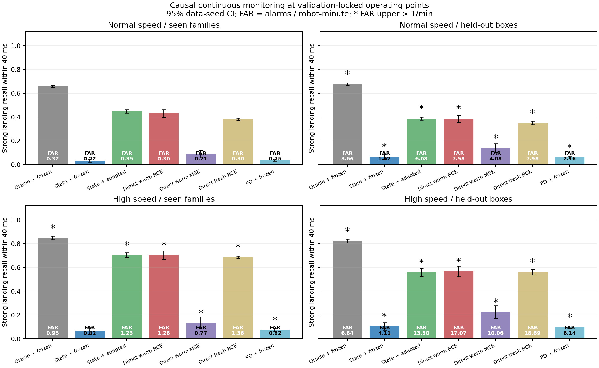

# Go1：从事件对齐评估走向因果连续流监测

本报告对应 `feat/go1-impact-causal-stream`，承接 [上一阶段结果](GO1_IMPACT_OBSERVABILITY_RESULTS.md)，不覆盖此前的回归、分类或 Replay 实验。固定方案见 [实验计划](GO1_IMPACT_CAUSAL_STREAM_PLAN.md) 和 [配置](../configs/impact/causal_stream_v1.json)。五组正式实验、独立原生标签审计及保存记录复算均已完成。

## 本阶段结论：冻结模块复用失败，连续流监督有效，跨场景和时延尚未过关

原定主判据未通过，实用性判据也未通过。学习状态门控加冻结BCE头，比直接连续流热启动BCE低 **39.69个百分点**，配对95% CI **[-42.98,-36.40]个百分点**。因此不能把上一阶段事件对齐的高AUC，转述成已经可用的因果冲击监测器。

所有下表工作点均来自普通速度、训练地形家族的独立验证集。FAR为次/机器人分钟，四足合并；OOD列即使检出率较高，只要误报超预算，就不算通过。

| 方法，零额外延迟 | 普通/训练家族 检出率；FAR | 普通/箱块 检出率；FAR | 提速/训练家族 检出率；FAR | 提速/箱块 检出率；FAR |
|---|---:|---:|---:|---:|
| 因果真值门控＋冻结BCE，诊断参照 | 65.86%；0.325 | 67.71%；3.665 | 84.73%；0.946 | 82.13%；6.842 |
| 学习状态门控＋冻结BCE，原主方案 | 3.30%；0.223 | 6.49%；1.917 | 6.47%；0.421 | 10.44%；4.107 |
| 学习状态门控＋已适配BCE | 44.67%；0.347 | 38.72%；6.081 | 70.36%；1.226 | 55.85%；13.503 |
| 直接连续流BCE，旧头热启动 | 42.99%；0.302 | 38.51%；7.577 | 70.23%；1.281 | 56.73%；17.069 |
| 直接连续流MSE，旧头热启动 | 8.75%；0.211 | 13.90%；4.084 | 13.23%；0.772 | 22.37%；10.065 |
| 直接连续流BCE，从头训练 | 38.21%；0.298 | 35.01%；7.984 | 68.47%；1.362 | 55.99%；18.685 |
| PD线性门控＋冻结BCE | 3.51%；0.248 | 5.92%；2.163 | 7.31%；0.819 | 9.74%；6.136 |

普通条件下，直接热启动BCE检出率为42.99%（95% CI39.73–46.24%），FAR0.302；学习门控配冻结头仅3.30%（2.07–4.52%），FAR0.223。二者正常测试FAR汇总上界分别为0.507与0.561，满足1/min的测试预算，但原主方案漏检严重。状态门控对强落地的及时覆盖率却达98.39%，所以主要损失不在“完全找不到落地”。在门控有及时候选之后，冻结头的分数及其严格工作点仍拒绝了大量事件；不能把全部差距都解释成阶段不可观测。

将同一个连续流适配头加上状态门控后，检出率44.67%（43.13–46.22%）、FAR0.347；相比直接使用该头仅增加1.68个百分点，配对95% CI[-0.24,+3.61]，**没有建立明确门控收益**。因此本轮不支持把“额外的学习门控结构”直接包装成已经验证的创新。新头优于冻结旧头则说明：需要把背景和触发误差纳入严重度训练，不能只在真值对齐落地上拟合，再假设接上学习触发器就可以工作。这个比较同时改变了监督分布与更新状态，尚未单独识别究竟哪一种背景样本或时刻偏移起决定作用。

热启动直接BCE比从头BCE平均提高4.77个百分点，95% CI[1.43,8.12]，是次级证据，说明旧表示可以作为初始化继续利用；它不等于旧模型可以冻结部署，更不等于已经证明Replay有效。

## 误报迁移、回归与时延

直接BCE在箱块上的普通速度FAR为7.577，提速箱块为17.069；状态门控加适配头分别为6.081和13.503，均远超1/min。提速但仍为训练家族时，两者FAR为1.281和1.226，汇总上界还更高。即使因果真值门控，普通箱块FAR也达3.665。这表明既有门控问题，也有严重度/阈值的分布迁移问题；换一个更好的接触检测器不能自动解决全部校准问题。当前没有任何证据支持它已达到跨场景稳定可用。

正常条件的直接BCE比连续严重度MSE高34.24个百分点，配对95% CI[31.68,36.80]。两者实际FAR并非精确相等，故进一步做了**明确标为事后的测试标签工作点诊断**：在经验FAR≤0.5/min时，直接BCE可达49.34%检出率，MSE15.58%；≤1/min时分别58.55%与25.73%。这说明差异不能仅用原MSE阈值比较保守来解释，但这些诊断工作点借用了测试标签、只用1024点经验曲线、没有原方案的bootstrap约束，不能用于部署或替代确认性统计。结论仍限于本轮的事件概率监督与连续严重度监督比较，不能归为“MSE无法学习接触力”。

20 ms延迟、并重新在验证集内选到严格FAR预算后，正常条件下BCE的可用检出率接近0；但及时的状态门控覆盖率仍有83.90%。用**原零延迟阈值**直接评估延迟包，直接BCE仍能在40 ms内检出35.20%，只是FAR升至17.966。其中98.50%的误报是同足强落地后40–80 ms的报警，即错过规定截止时间，而不是完全无关的背景报警。适配门控版本对应37.98%、15.391/min，97.88%的误报同属这种超时强事件。不能说“延迟让信息消失”；准确说法是：**没有针对时延重训的50 Hz检测器，在40 ms硬截止和低超时报警预算共同约束下失效**。本轮没有验证延迟感知训练能否改善它。

在零额外延迟的正常条件下，直接BCE成功命中的事件中，仅约45.88%的报警早于原生40 ms窗口内首次最大接触力，命中事件的延迟中位数约13 ms。该统计条件化于成功命中，不能被写成所有冲击均有提前量，也没有计入实际通讯与执行延迟。滤波loading-rate的较晚峰值不能用来宣称对真实力峰有足够控制提前量。

## 可讲的研究故事与下一步

现阶段最有证据的故事是：**从仿真接触监督学习到的表示可以复用，但事件对齐准确性、连续流可靠性、时限可用性是三项不同要求；缺少背景监督与时序定义的一环，极高离线AUC仍可能对应很差的实际报警能力。** 已实现的是一个独立、可复算的Go1监测研究模块和对照链条，不是已经验证的控制改进，也不是一个优于直接预测的门控新算法。

若继续研究，优先应在统一二值目标下对比BCE与概率MSE/Brier，再加入连续严重度回归辅助头，隔离损失与目标差异；同时把“无冲击误报”和“真实冲击超时”分别评价，在保持策略50 Hz的情况下单独验证更高频本体输入及延迟感知训练。只有这些目标稳定后，再做有监督来源明确的在线适配、跨分布固定测试与Replay；本轮没有Replay对照，不能据此新增“Replay有效/无效”的结论。真机在线监督如何获得也需要单独说明，不能把仿真privileged contact默认当作硬件可用信号。

## 这轮究竟验证什么

上一阶段的高 AUC 回答的是：**已经知道落地发生，且在指定时刻取样时，本体观测能否区分严重度？** 它没有回答：**不知道落地时刻时，能否在整个连续流中可靠报警？** 本轮把接触触发、背景负样本、实际可用时刻和连续误报纳入评价，允许模块化方案失败。

机器人继续使用冻结的 HIMLoco-Go1 PD 策略，没有 PPO 更新、奖励调整、admittance 或静音步态目标。4096 个环境，400 Hz 物理、50 Hz 观测，Kp=40、Kd=1、动作尺度0.25。输入仍为当前及五帧历史的45维本体观测；训练标签可以读取仿真接触力，部署候选模型不读取接触力、地形编号或未来帧。

七类地形沿用上一阶段：平地、粗糙面、上下坡、上下台阶、随机箱块；共84个共享 tile，前六类参与训练，箱块只用于估计器的留出评价。普通速度0.4–0.9 m/s，提速1.0–1.1 m/s，每次重置重新采样。4秒短 episode 与位姿、关节重置扰动控制行程范围。起步平台仍属于数据分布；箱块也不意味着原始 locomotion policy 从未见过。材料参数不作本轮随机化，因此不能代表所有动力学变化。

## 标签、时序与评价口径

本轮明确监测**符合定义的落地冲击**，而不是全部接触冲击：同足至少40 ms接触合力幅值不超过5 N，随后两个400 Hz样本超过5 N。首个高样本记为原生索引k，物理发生时刻为(k+1)×2.5 ms。

严重度S沿用上一阶段：接触合力幅值先做因果20 ms均值，再计算相隔20 ms的正向差分，取落地后40 ms内最大值；S>2000 N/s为强事件。这是仿真的法向接触合力幅值代理，包含滤波延迟；既不是原始数值导数，也不是已验证的真机 loading-rate。持续支撑中的冲击和不足40 ms离地的重接触不在本轮主标签范围内。

一次报警只有在同足的[落地时刻,落地时刻+40 ms)内才算命中，提前或超时均不算。误报数除以机器人有效运行分钟，四足合并计数。所有方法使用相同的100 ms安静窗口规则：当前分数超过阈值，且此前五个同episode策略时刻均未超过阈值，才报警。规则是因果的；不在事后用真值事件消除重复报警。

真值接触触发仅是诊断参照，而且必须等到第二个高力样本可用：最早触发边界为ceil((k+2)/8)。它不是部署方案，也不保证是所有网络的数学性能上界。学习接触状态使用双阈值和连续两个低状态包重新置备；另有直接学习起点脉冲的门控，以及每足13参数、共52参数的PD响应线性接触基线。PD代理由q、dq、历史动作及速度差分计算，不是假设额外获得真实力矩传感器。

完整观测包额外延迟20 ms的实验只移动输入及其触发可用时间，不改变物理策略，也不伪造50 Hz记录无法表达的5/10 ms延迟。边界t的输入最多读取pre[t]，历史在已知episode重置处填充，不跨episode。开头500 ms以及未来严重度标签不完整的尾部不计分；状态机仍运行，不因真值评价掩码而重置。清楚报告被排除的事件与终止数。

## 网络与公平性边界

每个数据复制训练两个初始化的五种270→128→64→4 MLP：接触状态BCE、起点脉冲BCE、从头训练的连续流BCE、旧BCE头热启动的连续流BCE、旧MSE头热启动的连续流MSE。所有新头固定30000次更新、batch1024，使用独立Adam状态，保留最终权重，不按测试或最佳验证分数选点。两种热启动分别复制旧模型及其归一化，并检验初始输出一致；旧优化器状态没有被恢复。另训PD线性接触模型。

比较三层：第一层是因果真值门控、学习状态门控、脉冲门控、PD门控配**相同冻结严重度头**；第二层是完整连续流的从头/热启动BCE与热启动MSE；第三层是在最终测试前明确追加的对照，将**同一个已适配连续流的头**加上状态或真值门控。后者无需额外训练，分离门控效果与严重度头适配效果。追加时间、原因与当时完成的工作已写入计划。没有因为后来观察到的测试表现更换主终点。

单个MLP为43204参数，PD基线为52参数。门控加严重度需要两张网络；直接头只需一张，不能声称它们部署开销相同。旧头复用与直接头适配也不构成纯粹的架构优劣检验。训练时MLP每批使用全部四足标签，旧事件任务每条样本只监督事件所在足，训练量口径应一并保留。

## 工作点和统计约束

验证集只使用训练地形家族，按tile_id modulo3分组：0组选门控阈值，1组选报警阈值，2组仅监视与独立验证。报警工作点在128个分数分位点及禁用点中选择，以tile-bootstrap95%误报上界≤0.5次/机器人分钟为约束，最大化检出率。最终评价阈值不读取测试标签。零次误报不被解释为零风险。

所有五组模型、门控与工作点先锁定哈希，再收集/打分最终测试。唯一确认性主终点为：普通速度、训练地形家族的新轨迹上，“学习状态门控+冻结BCE”相对“直接热启动BCE”的检出率差，先平均两次初始化，再计算五组独立数据复制的配对t95%置信区间；要求下界>3个百分点，且双方测试误报上界≤1次/分钟。实用性另要求该状态门控方法检出率下界≥70%，四种速度/地形组合均满足误报上界≤1。失败是有效结果，不事后更换成功标准。

误报报告数据复制间不确定性及每组tile-bootstrap上界；汇总采用两者的较大者，并附零计数时假定Poisson过程的诊断上界。它不是分布无关保证，tile内共享物理场景也不被当作独立环境。每足和每tile的原始计数保留在结果JSON中。

## 如何解释 BCE 与 MSE

本轮BCE监督的是最近40 ms内是否发生强落地事件；MSE监督的是该窗口内的连续严重度、窗外为0。它们不仅损失不同，目标统计量和历史初始化也不同。平方误差的理想点预测对应条件均值，报警需要的则是超阈值概率，两者一般不能互相还原。例如一个观测条件下S总接近2100，另一个条件下S以0.3概率达到10000、其余为0，后者均值更大，却未必有更大的超阈值概率。这是目标选择问题，不能据此说数值回归学不准。点预测的损失需与目标统计量匹配，参见 [Gneiting, Making and Evaluating Point Forecasts](https://arxiv.org/abs/0912.0902)。

对二值标签本身使用概率平方误差（Brier）同样可以学习事件概率；对数评分与二次评分都属于适当概率评分。因此，如果要归因到BCE本身优于MSE，仍需统一二值目标、输入、初始化与预算的损失对照。参见 [Gneiting & Raftery, Strictly Proper Scoring Rules, Prediction, and Estimation](https://sites.stat.washington.edu/raftery/Research/PDF/Gneiting2007jasa.pdf)。本轮提供的是实际报警任务中的方法比较，不能推翻此前MSE能学习有限时间接触力与滤波loading-rate的结果。

## 可复现与保留范围

执行：`conda run -n himloco_lab python scripts/impact/run_causal_stream.py`。配置的开发集独立于正式五组，只有100步开发训练，用于发现索引和流程错误，未作为正式研究结果。项目64项检查通过；其中新增检查覆盖触发因果性、重置隔离、原生时刻换算、报警压缩记录与穷举一致性、分数阈值浮点边界、PD输入缩放和独立模型梯度。

每个正式数据角色都保留21个环境的完整原生接触力审计轨迹、64个环境的完整输入，以及事件表；验证和最终测试另保留相应网络原始输出、稀疏报警区间和统计。`verify_causal_stream.py`在不依赖完整观测缓存时重新推理小样本、复算全部工作点，并核对每个已匹配报警的足、环境与真实时间窗。原始事件表和新增确认时刻/原生峰值位置的扩展表分别校验，避免将扩展前哈希误作扩展后哈希。

归档使用`preserve_causal_stream.py --cleanup`，先打包并逐成员读回核对SHA256，再只删除本轮完整pre、密集标签及预测缓存。不恢复此前220 GiB数据，不修改旧实验资料。最终权重在`logs/impact_causal_stream_v1/rep{1..5}/`，旧locomotion checkpoint与上一阶段严重度权重均保留。归档的实测大小和清理量见保存清单；此前的实验资料保持原状。

## 数据规模与复核

| 数据角色，五组汇总 | 符合定义的落地事件 | 有效机器人分钟 | 非时间截断终止数 | 未来标签不完整而排除事件 |
|---|---:|---:|---:|---:|
| 训练 | 5,630,670 | 11,809.065 | 169 | 58,131 |
| 验证 | 1,690,033 | 3,543.031 | 1 | 17,550 |
| 普通速度最终测试 | 1,688,597 | 3,543.040 | 0 | 17,527 |
| 提速最终测试 | 2,135,392 | 3,542.457 | 72 | 22,206 |

正式总计77,824,000个策略步样本，训练50个MLP及10个线性模型，另固定保留20个历史严重度头。原生标签逐角色独立复算；完整输入小样本重新推理最大原始输出误差为0.0，1360组最终工作点统计重新计算误差为0.0。非时间终止与标签审查尾部已显式列出，不能忽略它们后声称覆盖所有跌倒前冲击。

机器可读证据：[主汇总](../artifacts/impact/causal_stream_v1/summary.json)、[模型与工作点锁](../artifacts/impact/causal_stream_v1/model_lock.json)、[全部方法CSV](../artifacts/impact/causal_stream_v1/operating_results.csv)、[复核结果](../artifacts/impact/causal_stream_v1/verification.json)、[事后FROC诊断](../artifacts/impact/causal_stream_v1/posthoc_froc.json)、[时延归因](../artifacts/impact/causal_stream_v1/posthoc_delay_attribution.json)。
