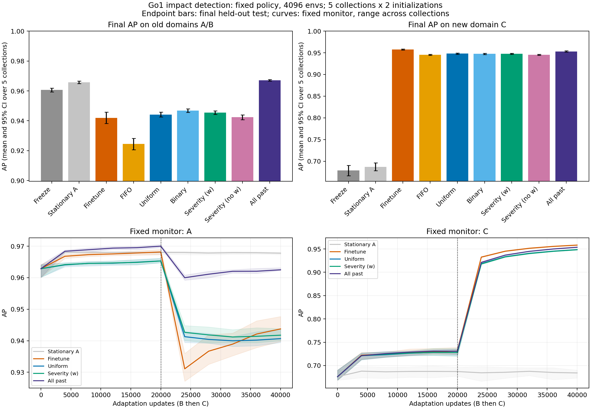

# Go1 冲击模块：持续适应与 Replay 实验结果

状态：主实验已完成。4096 环境，5 组独立数据采集 × 2 次网络初始化；主任务为刚完成区间的冲击识别 D/BCE。上一阶段力/加载率实验代码、权重及报告保持独立。

## 当前阶段结论

1. 直接学习新地形确实会损害已学过的旧域能力。直接微调的最终 A AP 相对 A-only 的配对差为 **-0.0191 [-0.0218, -0.0165]**；相对继续训练 A 的对照为 **-0.0242 [-0.0277, -0.0207]**。新阶梯能力同时明显改善，因此不是用冻结模型的稳定性冒充新域适应。
2. 8 MiB 随机 Replay 相对直接微调的旧域 AP 差为 **0.0021 [-0.0006, 0.0049]**，新 C AP 差为 **-0.0097 [-0.0102, -0.0091]**。旧域增益区间跨过 0，未获得稳定保留收益的证据。 而且改善不均匀：最终 A AP 为 0.9402，低于直接微调的 0.9433；旧域平均主要由 B 域改善拉高。不能宣布该配置稳定解决了遗忘。
3. **严重度分层未达到预设主判据，不能把严重度分层作为已验证的创新收益。** 二值分层是必要对照；只胜无 Replay 或随机记忆，不足以证明连续物理严重度提供了额外贡献。
4. 全历史参照使用同样 batch 和更新次数，但可读取全部已到达训练数据，旧域 AP 为 0.9670、新 C AP 为 0.9532。它用于揭示有限记忆方案与更多历史覆盖之间的差距，不是真正性能上界，也不能仅凭这个差距确定容量或过拟合的单一因果解释。

## 实验任务与预算

- 冻结 HIMLoco-Go1 PD 行走策略，Kp=40、Kd=1、动作尺度 0.25，指令 `(0.7,0,0)`。原 baseline 的 200 Hz 配置未改；本研究采集物理 400 Hz、策略 50 Hz。
- 输入为带配置噪声的本体 45×6=270D，MLP 128/64，四足独立输出但共用一个网络。privileged contact 只生成标签和选择记忆，不进入部署输入。
- S20 为 20 ms 平滑载荷正向差分在刚完成区间的最大值，事件阈值 2000 N/s。它是有限时间尺度的仿真接触加载代理，既不是未来峰值预测，也不是原生单步差分，更不等于真实力传感器测得的物理冲击真值。
- A：平地/1–4 cm 粗糙地；B：坡度 0.05–0.25 的上下坡；C：2–10 cm 上下阶梯；U：2–10 cm 随机块，仅评价。U 上的好坏叫泛化，不能叫遗忘。
- 4096 是每次采集的总环境数：七类各约 585 个环境，A/B/C 各约 1170、U 约 585，不是每种地形各 4096。每角色 84 个地形块被多个机器人共享；增大机器人数量不等于同等增加独立几何实例数。
- 每组 train/monitor/calibration/test 使用各自独立 seed；角色按完整轨迹和地形实例分开，排除每次 reset 后 500 ms。没有随机拆相邻帧。四足和共享地形机器人的帧不充当独立重复。
- A-only 60,000 更新；B、C 各 5 个时间块，每块 4,000 更新。两次初始化分别训练；之后每种方法克隆相同初始权重、归一化和完整 Adam 状态，不在域边界重置 optimizer。学习率 A 为 1e-3，适应为 1e-4。
- 所有适应方法 batch=2048。Replay 为 1024 当前+1024 旧样本，微调为 2048 当前；这是匹配总计算，当前样本曝光量不同。全历史参照也采用同样的 1024+1024 预算。
- 每个到达块先预测，再训练；训练结束后每条唯一记录只入库一次。块退出后，受限 Replay 方法只读取自身存储载荷，不用旧磁盘行号绕过内存限制。

阶段 0 的 pilot A 监测 AP 在最后 20,000 更新基本进入平台区；没有用欠训练初始化制造遗忘。正式阶段统一固定最后一步 checkpoint，不按 monitor 或 test 选最好结果。

## 记忆机制

每条记录存 float32 270D 本体历史、float32 8×4 连续标签、int8 层号和 float64 reservoir priority key，主容量为 **6889 条机器人区间**；另预留状态开销。分层配额向下取整会少 1 条。序列末最大实测序列化载荷为 **8384831 B**，小于 8,388,608 B，包含 RNG 和累计层计数。

**8 MiB 指可访问的唯一历史记录及其序列化状态预算。** 实现为加速训练，将同一批允许记录另缓存于 GPU，没有增加可回放的旧样本；由实际行数计算的稳态 CPU+GPU 持久数组负载最大共 **16733381 B**，约 16 MiB/方法，另有共享离线数据集、模型/optimizer 和临时工作区。这不含 allocator 对齐，亦未测量完整的每方法分配峰值；不能声称整个训练实现的物理占用≤8 MiB。严格的 CPU+GPU 合计≤8 MiB 部署实现尚未验证。各受限方法的逻辑预算和缓存策略相同。

随机 reservoir 从全部过去唯一记录均匀保留。二值分层按四足最大 S20 的 ≤2000 / >2000 划分，配额 1/2、1/2；严重度分层额外划分 2000–4000 与 >4000，配额 1/2、1/4、1/4。两种主分层方法都用过去累计层频率与实际 buffer 层比例之比校正回放损失，避免将采样先验改变误当概率改善。严重度无校正版本单列消融。

FIFO 保留最近到达记录；它和随机/分层方法使用相同载荷和字节上限。所有层均按机器人区间而非单足计数；采样校正对应机器人区间的过去分布。

## 独立最终测试

每组先平均两个初始化，再对 5 组数据做配对统计。表中 95% CI 为数据组层面的 Student-t 区间。A/B/C/U 完整固定 monitor 在每个块端点评价；每 1000 更新的预先固定小样本 probe 用于记录曲线。全部方法和节点权重锁定后，才评分最终 test。

| 方法 | 最终旧 A AP | 最终旧 B AP | 旧域平均 AP，95% CI | 新 C AP | U AP | 平均遗忘 |
|---|---:|---:|---|---:|---:|---:|
| 冻结 A-only | 0.9624 | 0.9588 | 0.9606 [0.9593, 0.9619] | 0.6785 | 0.7068 | 0.0000 |
| 继续训练 A | 0.9676 | 0.9638 | 0.9657 [0.9648, 0.9666] | 0.6870 | 0.7074 | -0.0020 |
| 直接微调 | 0.9433 | 0.9406 | 0.9420 [0.9382, 0.9458] | 0.9577 | 0.8557 | 0.0305 |
| FIFO | 0.9242 | 0.9248 | 0.9245 [0.9207, 0.9283] | 0.9456 | 0.8315 | 0.0468 |
| 随机 reservoir | 0.9402 | 0.9481 | 0.9441 [0.9425, 0.9457] | 0.9480 | 0.8452 | 0.0273 |
| 二值分层（校正） | 0.9424 | 0.9513 | 0.9468 [0.9457, 0.9480] | 0.9475 | 0.8444 | 0.0246 |
| 严重度分层（校正） | 0.9414 | 0.9496 | 0.9455 [0.9443, 0.9467] | 0.9478 | 0.8463 | 0.0259 |
| 严重度分层（无校正） | 0.9371 | 0.9476 | 0.9424 [0.9407, 0.9440] | 0.9453 | 0.8422 | 0.0287 |
| 全历史参照 | 0.9623 | 0.9718 | 0.9670 [0.9666, 0.9675] | 0.9532 | 0.8607 | 0.0055 |

平均遗忘定义为 `[A0 的 A AP−最终 A AP + B 学完时的 B AP−最终 B AP]/2`；正数表示退化。Freeze 和 stationary A 没有学 B，其该列仅作漂移参照，不称为已学 B 的遗忘。A-only 共同旧任务的对照差已单独列在结论中。



过程与终点并不等价。固定 monitor 块节点上，A 域相对 A0 的最差下降均值：直接微调 0.0318、随机 Replay 0.0235、二值分层 0.0206、严重度校正 0.0222。Replay 减小了这组节点上的过渡期最差下降，但直接微调后期部分恢复，因此不能用早期有利节点替换预设最终终点来宣布胜出。这是描述性曲线结果，完整数据见 [monitor_curve_summary.json](../artifacts/impact/continual_replay_v1/confirmation/monitor_curve_summary.json)。

## 严重度增量：按预设判据验收

旧域实用增益门槛是相对随机与二值两个参考均 >0.01，两个方向性检验做 Holm 校正；同时要求对两者的新 C AP 差的 95% CI 下界均 >−0.01。不能看到 test 后降低门槛。

| 比较 | 旧域平均 AP 差，95% CI | 新 C AP 差，95% CI | Holm p（旧域增益 >0.01） |
|---|---|---|---:|
| 严重度校正 − 随机 reservoir | 0.0014 [0.0004, 0.0023] | -0.0001 [-0.0004, 0.0001] | 1 |
| 严重度校正 − 二值分层（校正） | -0.0013 [-0.0017, -0.0009] | 0.0003 [0.0001, 0.0005] | 1 |

下面保留每组配对差，避免将大量帧造成的视觉稳定当成独立重复：

| 独立采集组 | 随机 − 微调：旧域 AP | 严重度 − 随机：旧域 AP | 严重度 − 二值：旧域 AP |
|---|---:|---:|---:|
| 1 | 0.0046 | 0.0014 | -0.0017 |
| 2 | 0.0004 | 0.0005 | -0.0013 |
| 3 | -0.0003 | 0.0021 | -0.0009 |
| 4 | 0.0041 | 0.0008 | -0.0012 |
| 5 | 0.0019 | 0.0022 | -0.0015 |

没有通过优势检验不等于数学上证明所有设置下完全无效。本结论限定为这个二值目标、网络、几何序列、8 MiB float32 记忆与固定预算；其他容量、目标和选择机制需要另立实验。

五组仍是小样本，t 区间和检验依赖配对差的近似分布假设。逐组差值保留在上表与 JSON 中；没有把数百万帧带来的小标准误误当成独立采集证据。

## 排序能力与报警工作点

各初始化在独立 A 校准数据上拟合初始单调校准器，并在地形行 modulo 3 的另一区域选择经验 FAR≤0.5 的最高召回阈值；剩余区域只验证一次。主保留诊断固定初始 A 阈值。另列的方法专属重校准/重选阈值使用额外旧 A 校准标签，是明确的 oracle，不是无监督部署适应。

FAR 单位均为次/机器人·分钟，四足合计；不能用低 FAR 单独判断模型更好，因为停止报警也能降低 FAR。

| 方法 | A raw Brier | 初始固定阈值 FAR/min | 初始固定阈值事件召回 | 有标签重选阈值 FAR/min | 有标签重选阈值召回 |
|---|---:|---:|---:|---:|---:|
| 冻结 A-only | 0.00405 | 0.426 | 0.517 | 0.426 | 0.517 |
| 继续训练 A | 0.00374 | 0.584 | 0.575 | 0.431 | 0.550 |
| 直接微调 | 0.00485 | 0.075 | 0.201 | 0.484 | 0.360 |
| FIFO | 0.00562 | 0.527 | 0.277 | 0.464 | 0.269 |
| 随机 reservoir | 0.00507 | 0.739 | 0.400 | 0.455 | 0.354 |
| 二值分层（校正） | 0.00520 | 1.566 | 0.485 | 0.493 | 0.364 |
| 严重度分层（校正） | 0.00510 | 1.201 | 0.457 | 0.470 | 0.359 |
| 严重度分层（无校正） | 0.00547 | 2.373 | 0.518 | 0.483 | 0.345 |
| 全历史参照 | 0.00396 | 0.049 | 0.314 | 0.443 | 0.499 |

AP 下降反映排序能力退化，单调重校准不能恢复 AP。固定阈值 FAR 的变化还包含决策工作点漂移，不能全部归因于表示遗忘。每组原始结果同时保留固定校准器 Brier、重拟合 Brier、阈值验证结果和逐地形块报警计数。

本轮两者都能观察到：直接微调 A AP 从 0.9624 降到 0.9433；其固定阈值召回仅 0.201，重选阈值后为 0.360，仍低于冻结模型的 0.517。反过来，全历史模型的 A AP 为 0.9623，接近冻结模型，但固定阈值召回为 0.314，重校准/重选阈值后为 0.499。这说明仅观察某个固定阈值的告警变化，会把明显的工作点漂移与排序退化混在一起。

本表是工作点诊断，**没有给出通过全部报警效用门槛的主张**。Poisson 上界仅为诊断，不能代替计划中的地形/数据组聚类 FAR 验收；零误报也不等于已知 FAR 为零。不对未来未知场景承诺 FAR≤1。

## 存储、审计和复现

原始候选方案见 [实验计划](GO1_IMPACT_CONTINUAL_REPLAY_PLAN.md)，实际执行见 [锁定配置](../configs/impact/continual_replay_v1_lock.json)。相对初稿的调整均在正式训练前明确：使用已验证原采集器逐角色暂存，再转换为 I0 compact 格式；没有宣称已实现或验证新的仿真内流式 writer。记录实际为 492 B/机器人区间，加头部与小型审计文件。

每次采集仍是 4096 环境。正式 native 审计预先固定 env IDs `0,200,…,4000`，共 21/4096，保留全部时间片段；与原 cache 标签逐项复算最大误差为 0。终止区间/历史/reset 检查通过。所有场景保留终止和暴露统计；20 个采集角色合计非超时终止为 A=0、B=0、C=0、U=14。完整终止区间被保留，满足统一 500 ms 起始排除条件的区间参与评价，不只筛选幸存 episode；起始排除内的失败仍计入终止统计。

按磁盘约束，完成审计后清理本阶段大体积 `.npy` 缓存，保留有效权重、报告、历史哈希、metadata 和上述小规模 native force/target/proprio 审计片段。审计片段保存连续 pre/post 45D、reset、地形信息，可复算标签和检查因果历史；它不是完整统计测试集的替代。完整逐帧分数重算需要重新采集，PhysX 不保证重采集逐比特一致。上一阶段已删除的约 220 GiB 数据没有恢复或复制。

每组另保留 `logs/impact_continual_replay_v1/confirmation/rep*/final_training_state.pt`，含模型、Adam、RNG 和受限 Replay 内容；清理可从磁盘回读全部旧数据的参照索引及重复恢复文件。小型方法/权重快照和清理记录见 [本阶段保存索引](../artifacts/impact/archives/continual_replay_v1_20261104/README.md)。

复现入口（仓库根目录、conda `himloco_lab`）：

```bash
python scripts/impact/collect_continual_pilot.py
python scripts/impact/run_continual_pilot.py
python scripts/impact/run_continual_confirmation.py
python scripts/impact/plot_continual_results.py
python scripts/impact/verify_continual_results.py
python scripts/impact/audit_continual_native.py
```

这是执行顺序记录，不是在数据清理后能直接重新读取全部轨迹的承诺。小型审计可直接重算；完整重跑需在新 run 目录重新采集，避免混用已锁定输出。

本阶段没有改变 PPO、baseline Actor/Estimator 或 PD 控制，没有声称闭环控制改善、真机在线监督学习或首次接触前预警。Brier 损失、P20、连续 MSE 复验、场景顺序、1/32 MiB 容量与片段记忆仍是次级未执行项目。上一阶段 MSE/分类结论不能被本轮 Replay 结果替代。

## 研究故事与创新边界

这套实现可以独立于 learned admittance：监督接触标签、因果本体输入、固定旧域监测、受限记忆和跨场景测试都已有独立接口与可审计结果。固定验证集在本轮用于显示模型变化，没有验证自动漂移报警器的误报率/检测延迟，也没有据此自动触发更新。

若主判据未通过，就保留负面结果，不把“增加 Replay”或“利用物理严重度”本身当成已证创新。当前更值得区分的问题是：有限旧数据覆盖不足、反复训练小 buffer、以及记忆选择与二值目标的匹配程度。全历史与受限记忆的差距提供研究线索，但不能单独确定这几项的因果贡献。

后续优先设计容量与状态覆盖的独立消融，再考虑片段记忆或新的预测头；新方法须保留相同字节/计算和普通二值平衡对照，并使用新的最终测试 seed。不能围绕已经查看的本轮 test 挑选设置，再把同一 test 当作未知验证。

机器可读主结果：[summary.json](../artifacts/impact/continual_replay_v1/confirmation/summary.json)；逐组 `rep1…rep5/test.json` 保留两次初始化；审计：[final_verification.json](../artifacts/impact/continual_replay_v1/final_verification.json)。
