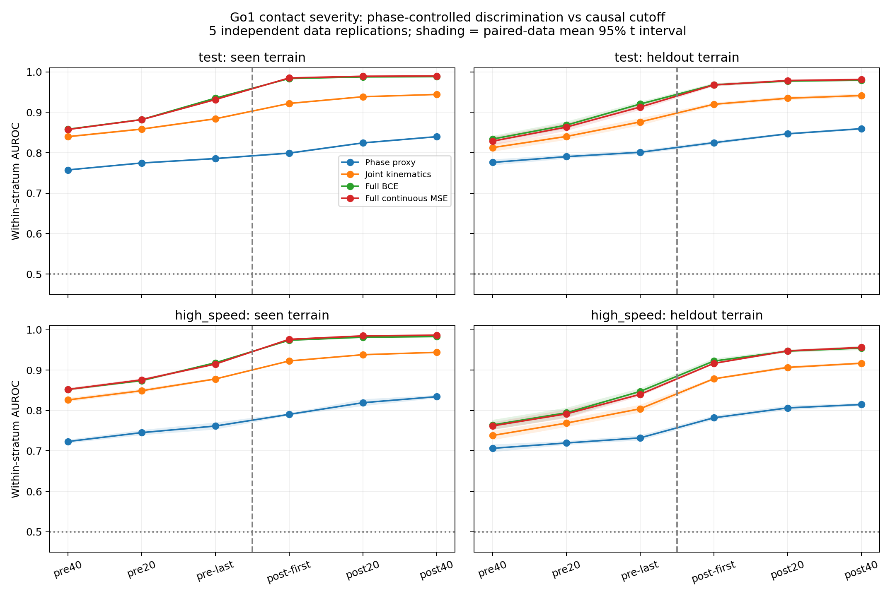

# Go1 冲击严重度：接触时序与额外本体信息验证结果

状态：正式实验完成。4096 总环境，五组独立采集 × 两次初始化，三个输入组、四种方法、六个截止时刻，共 240 个独立 MLP。所有权重锁定后才评分最终测试。

## 阶段结论

1. **在本轮事件定义、固定策略和近似匹配模型规模下，完整本体历史包含超出所选相位代理的严重度信息。** 正常速度未见随机块上，早期接触后分层内AUC为0.9683，相位代理0.8250；五组差值全部为正，预设实用门槛通过。这是额外可用信息的实证，不是对所有可能相位模型或传感信息下界的证明。
2. **接触前存在统计上的风险区分度，接触后的观测进一步改善结果。** 最后接触前边界的完整BCE AUC为0.9205；第一接触后边界为0.9683。前者使用privileged onset离线选样，并只保证早于5 N定义的起点，不能称为已实现连续流、严格几何无接触的预警。
3. **本轮没有显示分类对连续MSE的普遍优势。** 主时刻未见随机块上二者AUC为0.9683/0.9678，BCE−MSE差0.0005，95% CI为[-0.0002,0.0012]。这是次级诊断，不是预注册等价检验；部分更早时刻BCE较好，部分接触后时刻MSE较好。不能因这轮MSE同样能排序，就抹去上一阶段特定报警任务的事件监督收益。
4. **区分度能迁移，固定工作点仍明显失稳。** 完整BCE在正常速度同类/随机块、高速同类/随机块上的弱接触FPR分别为2.52%/6.33%/13.12%/23.34%，尽管各条件AP均很高。当前估计器尚不能作为已经验收的跨场景报警器。

这轮支持继续研究独立的本体冲击严重度模块。当前MLP及“仿真监督接触估计”本身不作为新算法创新；下一项关键缺口是：能否用部署可得的因果接触阶段定位替代真值对齐，并在连续流中保住严重度区分度与可靠工作点。Replay暂时保留为后续对照。

## 预设主比较

正常速度、训练排除的随机块、首次接触后可用策略边界处：完整 BCE − 相位代理 BCE 的分层内 AUC 差为 **0.1433 [0.1413, 0.1453]**。预设实用门槛为差值的 95% CI 下界 >0.03；本轮**通过**。五组配对差为 `[0.1412415544306197, 0.14244770503026638, 0.14312534783366737, 0.14417563213369, 0.14553202429970136]`。

这一比较只检验超出所选运动学相位代理的额外信息；代理不是所有可能时序信息的充分统计量，不能声称彻底排除了时序解释。完整本体的关节速度、姿态、动作等也可能编码地形或接触动态，本轮不将其归因于单一通道。

完整BCE相对关节组的次级AUC差为0.0483 [0.0461,0.0505]。相位/关节/完整模型分别为41,156/37,636/43,204参数；参数只近似匹配，网络宽度也不同，且未独立HPO。这个对照不能单独确定角速度、重力方向或动作的因果贡献。

## 实验方式与时间语义

冻结原 HIMLoco-Go1 PD actor、HIMEstimator、Kp40/Kd1、动作尺度0.25，不更新 PPO，不加入控制或 quiet reward。原 baseline 200 Hz 配置保持原样，本研究采集 400 Hz 物理、50 Hz 本体输入。训练速度0.4–0.9 m/s，高速留出1.0–1.1 m/s；每次 reset 采样指令。七类地形共享84个几何块，六类训练，随机块排除；四秒 episode 约束移动距离。4096不是每类地形各4096，也不是4096份独立几何。

主指标包含机器人经过起始平台、进入地形的自然接触轨迹，没有单独按障碍接触子集验收；随机块类别的测试事件不保证每一次都实际踩到凸块。因此本轮不能声称在纯障碍碰撞子集上验证了同等收益。

接触起点是同足连续40 ms不超过5 N之后，连续两个400 Hz样本超过5 N，取第一个时刻。结果为起点后40 ms内的20 ms平均载荷正向20 ms差分峰值，事件阈值2000 N/s。它是仿真有限时间尺度法向合力代理，不是原生瞬时导数、完整摩擦合力或硬件力真值。

这些例子均由 privileged 接触起点离线对齐；模型输入不含接触真值、地形ID或未来量。这是**事件对齐的可观测性诊断**，尚不提供部署时事件触发器、连续报警 FAR 或控制收益。不能将本轮事件窗口AP与过去全区间AP直接比较，因为标签窗口与事件比例不同。

特别地，接触前AUC是在离线已经知道这些窗口对应即将接触的条件下比较强弱接触，不能当作连续行走中提前发现未知接触的能力。六种截止分别训练独立头，部署时尚缺少对应的因果接触阶段定位。

| 输入截止 | 实际相对接触时刻范围 | 含义 |
|---|---|---|
| pre40 | −60 至 −42.5 ms | 最后接触前边界的前两步 |
| pre20 | −40 至 −22.5 ms | 最后接触前边界的前一步 |
| pre-last | −20 至 −2.5 ms | 严格早于本轮5 N定义的接触起点 |
| post-first | 0 至 17.5 ms | 第一帧不早于接触起点 |
| post20 | 20 至 37.5 ms | 已观察到部分甚至接近完整结果窗 |
| post40 | 40 至 57.5 ms | 结果窗已结束，仅为事后可观测性参考 |

接触前只指本轮力阈值和采样分辨率定义之前，不等于几何上严格无接触；本轮也未计入硬件测量陈旧、推理和通信时延。接触后早期分数可能同时利用已出现的冲击信息，不能将整窗识别称为未来剩余峰值预测。

20 ms平均及差分本身会改变峰的时间；即使平滑loading-rate的最大值还未出现，也不能推出原生力峰尚未发生，或仍有足够控制提前量。可观测性、滤波后的标签时间与物理可控制时间必须分别解释。

## 输入与公平对照

相位代理使用六帧四足髋俯仰位置/速度的单位圆表示，丢弃幅度，并加入当前指令；训练集拟合中心和尺度。关节组使用六帧完整关节位置/速度及当前指令；完整组使用270D本体历史，包括角速度、重力方向和动作。各组MLP隐藏层不同以近似匹配参数，实际参数数列在训练报告；不是每个架构都独立HPO后的最优上限。

每组、每个截止和初始化独立参数/优化状态；完整组同时对照相同连续严重度的MSE。统一自然事件采样、batch1024、30,000更新和学习率日程；采用固定最后一步，不按验证或测试挑最好权重。训练曲线保留，有限预算不代表信息论极限。

## 主时刻的四类泛化条件

| 测试条件 | 相位 BCE | 关节 BCE | 完整 BCE | 完整 MSE |
|---|---|---|---|---|
| test/seen | 0.7991 [0.7965, 0.8018] | 0.9220 [0.9208, 0.9233] | 0.9837 [0.9834, 0.9839] | 0.9852 [0.9848, 0.9855] |
| test/heldout | 0.8250 [0.8207, 0.8292] | 0.9200 [0.9159, 0.9240] | 0.9683 [0.9643, 0.9722] | 0.9678 [0.9642, 0.9714] |
| high_speed/seen | 0.7904 [0.7873, 0.7935] | 0.9226 [0.9221, 0.9231] | 0.9739 [0.9730, 0.9748] | 0.9761 [0.9750, 0.9772] |
| high_speed/heldout | 0.7819 [0.7766, 0.7872] | 0.8784 [0.8758, 0.8810] | 0.9223 [0.9160, 0.9286] | 0.9166 [0.9142, 0.9189] |

表为分层内AUROC均值及95%区间。分层使用足、接触前相位八分箱、指令速度四分箱及地形类别；类别仅用于离线评价。每层至少五个正事件和五个负事件，只统计层内正负对。高速指令落入最外侧速度箱，没有制造训练中不存在的相位观测。

## 未见随机块：随截止时刻变化

| 截止 | 相位 BCE AUC | 关节 BCE AUC | 完整 BCE AUC | 完整 MSE AUC | 完整 BCE AP |
|---|---|---|---|---|---|
| pre_40 | 0.7761 [0.7688, 0.7834] | 0.8127 [0.8025, 0.8229] | 0.8339 [0.8260, 0.8418] | 0.8287 [0.8187, 0.8388] | 0.8892 [0.8758, 0.9025] |
| pre_20 | 0.7904 [0.7852, 0.7956] | 0.8403 [0.8318, 0.8488] | 0.8682 [0.8593, 0.8772] | 0.8635 [0.8539, 0.8731] | 0.9125 [0.9004, 0.9247] |
| pre_last | 0.8011 [0.7963, 0.8060] | 0.8762 [0.8673, 0.8851] | 0.9205 [0.9148, 0.9262] | 0.9130 [0.9056, 0.9203] | 0.9444 [0.9376, 0.9513] |
| post_first | 0.8250 [0.8207, 0.8292] | 0.9200 [0.9159, 0.9240] | 0.9683 [0.9643, 0.9722] | 0.9678 [0.9642, 0.9714] | 0.9746 [0.9692, 0.9801] |
| post_20 | 0.8469 [0.8445, 0.8493] | 0.9349 [0.9305, 0.9394] | 0.9773 [0.9747, 0.9799] | 0.9787 [0.9760, 0.9814] | 0.9828 [0.9789, 0.9866] |
| post_40 | 0.8595 [0.8565, 0.8625] | 0.9416 [0.9371, 0.9460] | 0.9795 [0.9768, 0.9823] | 0.9812 [0.9783, 0.9841] | 0.9851 [0.9818, 0.9884] |

全条件、各初始化、分层覆盖率、校准Brier、弱接触FPR及召回、MSE整体/尾部RMSE见 `artifacts/impact/observability_v1/summary.json` 及各rep结果。AP依赖事件比例，不同域不能只凭AP高低判断迁移是否更好。

## 数值精度与固定工作点

以下均为第一接触后可用边界处的五组均值。MSE预测的是本轮40 ms事件窗内的平滑loading-rate峰，单位N/s；尾部按各组训练地形事件严重度的95%分位定义。它不是未来原生力峰的误差。

| 条件 | MSE RMSE | MSE尾部RMSE | 完整BCE AP | 完整BCE弱接触FPR | 完整BCE强接触召回 |
|---|---:|---:|---:|---:|---:|
| 正常速度，同类新轨迹 | 170.7 | 257.0 | 0.9898 | 2.52% | 89.56% |
| 正常速度，随机块 | 420.8 | 649.1 | 0.9746 | 6.33% | 89.26% |
| 高速，同类地形 | 220.7 | 290.4 | 0.9982 | 13.12% | 97.08% |
| 高速，随机块 | 521.8 | 722.4 | 0.9894 | 23.34% | 95.80% |

正常速度训练地形测试的阳性事件约49%，高速同类测试约91%。AP升高不能直接解释为识别更好；高速随机块的分层内AUC反而降至0.9223。主比较正常速度随机块的分层覆盖率约97.60%，其余情况和各时刻覆盖率完整保存。阈值只在训练地形验证数据选择，概率校准优化全部正常收敛。

事件条件化后减少了大量非接触区间，目标窗口也与上一轮全区间任务不同，这可能是本轮MSE风险排序很强的原因之一；但当前没有在同一目标下单独消融选样、类别比例和窗口长度，不能将此归因为唯一机制。

固定21环境审计片段的探索性时间诊断中，正常速度3,169个强事件仅约14.52%在post-first截止前已出现本轮平滑率峰；到post20约99.91%已出现。峰的中位时刻集中在接触后17.5 ms，体现了滤波/差分窗口的影响。这不证明原生物理峰尚未发生，更不证明有可用控制提前量。详见 `native_peak_timing.json`；没有依据该诊断改变任何主实验设置。

## 数据规模、审计与统计边界

五组保留事件数：{'train': 5627213, 'validation': 1193901, 'test': 1194952, 'high_speed': 1510771}。完整结果窗被终止或记录尾部截断的事件共113478，另排除每次reset后500 ms；正式采集合计非超时终止44。候选起点、初始排除、删失和各截止有效数量都保留在数据metadata。未满足40 ms低载荷间隔的擦碰/短重接触不在主事件范围，不能外推为所有impact类型。

train角色记录全套地形，但仅4,807,730个训练地形事件进入优化，819,483个随机块事件未进入训练或归一化。非超时终止按train/validation/test/high_speed分别为3/0/2/39；完整终止轨迹先由原采集器捕获，再按同一结果窗完整性规则处理，不能外推到被删失的事件。

21/4096个环境的完整原生接触和本体审计片段按固定env ID保留。原采集器检查历史、原/新增接触传感器一致性和终止捕获；独立审计从原生向量重算事件起点、严重度和reset边界。float32模长缓存产生的微小差异以N/s报告，允许误差0.01 N/s。

最终20个正式采集角色全部通过原生审计，共独立重算48,907个事件，最大差异0.0008965 N/s。43项科学契约测试通过；主结果已从保留的事件表、预测和分层编号精确复算，五组差值及CI与汇总一致。证据见 `verification.json`、`contract_tests.json`。

先平均两个网络初始化，再对五组独立采集计算t区间。大量事件、四足和共享地形机器人不作为独立科学重复。只有预设单一主比较作确认性判定，其余域、时刻与方法差值为诊断，没有对大量次级比较作多重校正。五组仍是小样本。

验证轨迹按tile_id%3分为概率校准、阈值选择、独立验证，仅使用训练地形类别。阈值取验证普通接触分数的97.5%分位；最终测试不再重选。这里FPR的负例为普通接触事件，绝不是每分钟连续流误报率，也没有未知域概率或误报保证。

## 复现与保存

协议：`configs/impact/observability_v1.json`；启动：`python scripts/impact/run_observability.py`，conda环境 `himloco_lab`。训练与测试脚本分离，`model_lock.json`保存240模型、方法源码和协议的哈希。权重位于 `logs/impact_observability_v1/rep*/{phase,kinematics,full}/models.pt`。

上一阶段方法、结果与有效权重保持独立。本轮大体积原始分片逐角色转换后删除；评分结束后按保存索引清理全量本体帧，保留事件表、预测、审计片段、权重、报告与哈希。事件表和小审计不替代完整本体测试集，清理后逐帧重训/预测需要重新采集，PhysX不保证逐比特一致。

本轮保存与清理索引：[observability_v1_20261105](../artifacts/impact/archives/observability_v1_20261105/README.md)。重新生成自动表格会覆盖本报告的人工解释部分，最终解释稿随归档保存。
