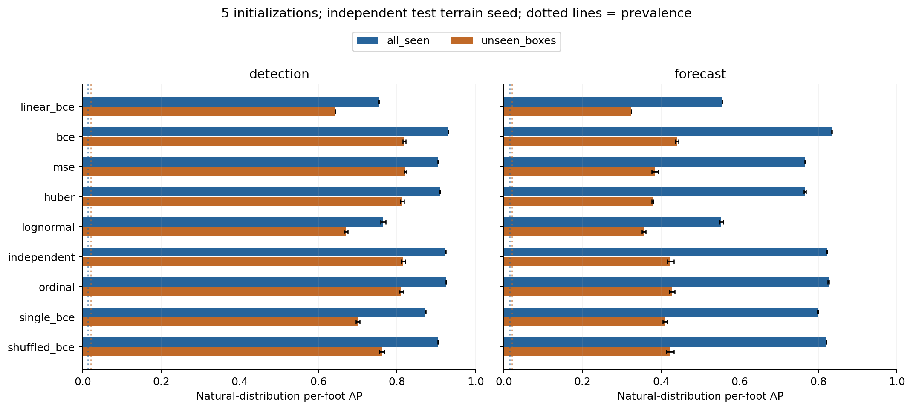

# Go1 Impact 第一步：物理标签诊断与静态可学习性

日期：2026-11-03。分支：`feat/go1-impact-replay`。本轮执行 A0/A1，不执行 Replay、PPO 重训、导纳控制或真机命令。

后续更严格的五组独立数据复验、二值 MSE 对照、物理步长扫描与七种预测方法比较见 [接触力/loading-rate 阶段报告](GO1_FORCE_LOADING_RATE_RESULTS.md)。本文件保留第一步的目标定义和结果，不与后续 20 ms 目标混用。

## 1. 这一步实际检验什么

先检验“仿真接触监督 → 本体感觉中的加载信息”是否成立，再判断哪种表示值得进入持续学习实验。把已发生事件识别 D 与未来 20ms 风险 P20 分开；不以分类精度替代控制效果，也不预设回归失败、有序头有效或 Replay 必要。

主监督称为 **快速法向加载代理量**，不直接称为真实碰撞力、碰撞能量或损伤风险。PhysX sensor 返回的是足端法向接触合力；不含完整摩擦力，同时相反法向可能抵消。与机械臂三维外力向量回归不是同一个任务。

## 2. 如何设置四足地形

正常落足也有冲击，不能只采集障碍或跌落。反过来，把所有 terrain、速度、摩擦、质量一起随机化，也难以判断模型到底学会了什么。第一步只改变几何，保持指令 `(0.7,0,0)`、同一摩擦/质量/PD 设置，无 push，开启原 policy 本体观测噪声。

| 家族 | 配置范围 | 作用 |
|---|---|---|
| 平地 | 水平平面 | 正常步态、常规落足与误报基准 |
| 连续粗糙面 | 高度采样 1–4cm；采样格 .2m、碰撞格 .1m | 无规则小幅加载变化；不把所有不平整都做成台阶 |
| 下坡 | 配置坡度比 .05–.25，中心平台 1.5m | 支撑方向、下降几何与正常落足变化 |
| 上坡 | 对应反向坡面 | 与下坡分开报告 |
| 下台阶 | 级高 2–10cm、级宽 .30m、中心平台 1.5m | 较大下落落足和重复离地/接触 |
| 上台阶 | 同样级高与级宽 | 抬腿跨越、可能撞台阶立面，与下台阶区分 |
| 离散凸块，整类留出 | 网格 .45m，高度参数 2–10cm | 未进入训练、模型选择、概率校准或报警点选择的几何族 |

坡度比按本机 height-field 实现的高度/距离比例理解，不把配置注释中的 radians 当作实际实现。生成器使用 `curriculum=True` 只为固定列类型与分层难度；环境的升降级 curriculum 关闭，episode 不迁移地形。

每次采集使用 **4096 env、84 块 12m×12m 地形**：6 行、14 列，每家族 12 块。机器人复用地形块；4096 不等于 4096 个独立地形。每 episode 6s，名义前进约 4.2m；数据准备检查实际位置不超过 5.5m 边界。对平地平台区域与离开平台后的结果另作分层。

初态加入受控变化：xy ±.25m、yaw ±.1rad、关节位置倍率 .95–1.05、关节速度 ±.1rad/s。它与质量/摩擦/推力随机化分开记录，避免克隆环境重复同一条轨迹。

train/validation/test 分别使用采集 seed 11/22/33。它们是独立生成与初态采样；平地本来几何相同，规则台阶也可能量化出相同高度，因此已见家族测试只声称同族泛化；凸块才是完全留出的新几何族。未进行相邻帧随机切分。

## 3. 规模、冻结项与时间边界

| 项 | 实际设置 |
|---|---|
| 原 locomotion | 已验证 HIMLoco-Go1 PD JIT，Actor 与 HIMEstimator 冻结 |
| PD/动作尺度 | Kp40、Kd1、.25，与 baseline 一致 |
| 仿真/输入频率 | 200Hz / 50Hz |
| 输入 | 六帧本体历史共 270D；不读 contact、terrain ID、地形高度或 privileged critic |
| 训练原始采集 | 4096×2500 = 10,240,000 transitions |
| 验证原始采集 | 4096×600 = 2,457,600 transitions |
| 测试原始采集 | 4096×600 = 2,457,600 transitions |
| 监督训练 | 排除凸块与各 episode 前 .5s，剩余 7,987,525 条训练 transitions |
| 更新预算 | 每模型 60,000 Adam steps，batch2048，122,880,000 次样本曝光 |
| 重复 | 5 个网络初始化，共享数据和配对初始 backbone；不是 5 套独立训练地形 |

原始采集合计 **15,155,200 transitions**。训练轨迹包含的凸块样本仅用于 A0 描述，完全排除于模型训练与验证。4096 是并行物理采集数，监督 batch 是另一维度。

D 输入区间结束时的当前帧及五帧过去，监督刚结束的 20ms；P20 输入动作前的六帧历史，监督下一个 20ms。不提供未来动作。terminal 使用 reset 前 `final_obs` 与接触 trace，不能换成 reset 后新一集的第一帧。跨 episode 不连接历史。

## 4. A0 标签及物理诊断

令 F 为足端法向合力向量的模长。先计算因果 10ms 均值，再取它相对 10ms 前均值的正增量，最后对当前 20ms 内四个物理子步取最大：

`S(W) = max_{t in W} [mean_10ms F(t) - mean_10ms F(t-10ms)]_+`。

量纲为 N。相较单步 dF/dt，它不会把单个物理步的尖峰直接除以 dt；它仍是快速加载代理量，不保证离散时间步完全不变。连续幅度保留，二分类阈值 40N，多阈值为 20/40/80N。它们是预设的操作性等级，不是危险阈值。事件合并同足间隔不超过两帧的正窗；不采用旧 5000N/s 阈值。

64 个独立初始高度（约 .401–.884m）、两种 physics dt 的受控零动作落地，初始 root state 逐项相同。每足只统计第一次接触后的 40ms，避免用整段支撑积分代替短窗冲击诊断。

| 量 | 200/400Hz 配对对称相对差异中位数 | 配对 Spearman |
|---|---:|---:|
| 瞬时峰值 | 45.6% | .869 |
| 未平滑的 10ms 正增量 | 52.5% | .922 |
| 10ms 平滑正增量 | **20.5%** | **.963** |
| 单步正 dF/dt | 121.5% | .833 |
| 首触后 40ms 载荷积分 | **3.73%** | **.985** |

这是支持有限物理时间窗、反对直接把单步差分当稳定 GT 的证据。但平滑增量仍未达到物理幅度收敛，第一步只能对固定 200Hz PhysX 的加载表示下结论。积分更稳定，值得后续单独研究“接触事件内冲量/载荷积分严重度”；它与当前任意 20ms 窗口的快速加载不是同一目标，也不能在测试后悄悄更换。

高度与每机器人平均平滑增量的 Spearman 在 200/400Hz 分别约 .985/.992，说明保留了落地严重度排序。每个机器人的四足不是四个独立统计重复。

工程上三组正式采集均通过 SHA256、episode/terminal 连续性、力窗口重叠、post→next pre 对齐、NumPy64 独立重算检查；部署历史重建、新旧传感器重叠误差均为 0。20 个 CPU 契约通过。原 checkpoint 与部署 JIT 的 SHA256 保持原值，baseline core 没有修改。

早期 400Hz 采集报告的 `force_order` 描述字符串误写固定 last four，数值 `window/decimation/history` 正确，实际取最后八个子步；分析代码均按数值窗口取样，现已修正文案。首次 terrain smoke 的 .4m 网格宽度整除 12m，触发 Isaac Lab 凸块边框约束；改为 .45m 后通过。失败目录保留，无失败样本进入正式数据。

## 5. A1 比较、校准与反捷径检查

统一小网络 270→128→64；各方法参数独立，不共享 encoder 或梯度，不把模型轴 loss 求均值。配对 seed 共享初始 backbone 和采样批次。模型轴向量化只用于加速。独立梯度测试与单模型结果一致。

- linear BCE：线性可分/简单周期模式参考。
- BCE：40N 单阈值分类。
- MSE：连续幅度、无非负约束；目标除 40 作量纲缩放，仍然是 MSE，不故意使用失衡数值尺度制造失败。
- Huber：非负幅度、稳健损失。
- log1p-normal：异方差概率回归，通过分布计算超阈概率。
- independent：三个独立阈值的 BCE。
- ordinal：三个阈值的有序 logits，结构上保证超阈概率随严重度递减。
- single BCE：仅当前一帧，其余标准化特征置零。
- shuffled BCE：保留当前帧、按固定样本排列打乱过去五帧，检验时间次序贡献；它仍保留历史集合，不是“无历史”。

2 万步时验证曲线仍明显下降，所以在查看测试结果前登记统一延长至 6 万步；学习率里程碑为 **30,000/45,000**，分别降到 3e-4/1e-4。最终总曝光覆盖训练池 7,987,523/7,987,525 条。最后一万步的选择目标改善均值，多数约 .1–1.2%；这支持接近平台期，不能证明全局最优。

validation 按 env index%3 分成模型选择、概率校准、报警点选择三组，原始 episode 不交叉；它们可能共享验证地形块，因此只是角色隔离，不是三套独立地形。模型按各自验证目标选 checkpoint。点回归不把幅度硬阈值当概率，而是与分类一起在单独校准集合上拟合正斜率 logistic 校准。

报警为因果阈值上穿，之前 100ms 不得有另一原始上穿；同足与真值事件重叠才匹配，不放宽未来容差。验证集在固定候选网格中选择满足 ≤1 次误报/robot-minute 的最高事件召回；测试使用已锁定阈值，**不保证域转移后的测试误报率仍然 ≤1**。

除全分布 AP/Brier、事件召回/真实误报率外，还报告：离开起始平台后的 AP、此前 10ms 法向合力 <1N 的窗口 AP，以及**条件于随后 20ms 确实出现 >1N 接触载荷**的 hard/soft loading AP。后者防止把预测接触载荷出现时刻当成预测加载严重度。该分层的 `precontact/strict_precontact/touchdown` 字段均是**按力定义的接触代理**，没有保存几何间隙/原生接触对，不能据此宣称严格几何接触前预警；无载贴地和短暂重接触仍可能存在。选择分层使用 privileged force，但它从不进入模型输入。随机打乱标签配对只作信息破坏诊断；尚未提供完整 gait-phase-only 模型或隐藏几何因果配对实验。

## 6. 结果与研究判断

完整数值、各初始化、各地形、验证阈值、置信区间与图保存在 `artifacts/impact/step1_20261103/`。以下结论以该目录的完成报告为准。

### 6.1 自然分布足端时间窗 AP

下表是五个初始化的均值 ± 标准差；不是五个独立数据生成 seed 的置信区间。同族新地形/凸块测试的正例比例分别约 .01473/.02168。比较同一列中的方法，不能用不同域之间 AP 的差值直接度量泛化损失的全部原因。

| 方法 | D 同族新地形 | D 未见凸块 | P20 同族新地形 | P20 未见凸块 |
|---|---:|---:|---:|---:|
| 线性 BCE | .7535±.0000 | .6434±.0000 | .5545±.0000 | .3234±.0000 |
| **BCE** | **.9301±.0006** | .8182±.0039 | **.8343±.0003** | **.4401±.0047** |
| MSE | .9051±.0010 | **.8210±.0036** | .7664±.0015 | .3837±.0080 |
| 非负 Huber | .9090±.0007 | .8133±.0049 | .7658±.0029 | .3782±.0023 |
| log1p-normal | .7648±.0067 | .6696±.0051 | .5527±.0049 | .3560±.0050 |
| 三个独立阈值 | .9235±.0009 | .8157±.0054 | .8217±.0011 | .4241±.0079 |
| 单调 ordinal | .9251±.0006 | .8105±.0062 | .8256±.0017 | .4273±.0070 |
| 单帧 BCE | .8717±.0011 | .7001±.0047 | .7989±.0016 | .4103±.0062 |
| 打乱历史顺序 BCE | .9041±.0004 | .7615±.0062 | .8199±.0005 | .4226±.0099 |



本体输入对固定仿真设置下的快速加载有明确识别信息，且部分信息可以用于下一时间窗风险排序。历史对 D 的收益明显；P20 中单帧和打乱顺序的结果也较强，不能把全部预测能力解释为复杂时序建模。

按“即将出现接触载荷”的条件分层，BCE 的 D AP 在同族/凸块为 .946/.915，P20 为 .863/.658；该分层正例比例 .211/.280。因此结果不完全等同于接触载荷出现时刻识别，但缺少 gait-phase-only 与隐藏几何配对对照，仍不能声称已经量化了不可观测性的物理极限。

**回归在本任务上有效，不能先验排除。** MSE 对当前平滑加载量的 D 同族 MAE/RMSE 为 .87/2.19N，凸块为 1.56/4.43N。然而全局误差受大量低载荷样本主导：>80N 分箱 MAE 分别约 10.0/21.5N；P20 的凸块 >80N 分箱 MAE 约 55.7N。无非负约束的 MSE 在 D 同族约 21% 标量输出为负，不能直接当作物理幅度使用；非负 Huber 提供可修复的对照。这些仍是加载标量，不是三维力方向估计。

当前 log1p-normal 实现明显较弱，只说明这个分布模型/训练设置不够好，不能推断概率回归或其他分位数、零膨胀模型均不可行。

**有序约束目前没有证明比简单 BCE 更好的研究收益。** 相对独立三阈头，同族有小幅改善；但其主 AP 低于 BCE，未见几何也没有稳定额外收益。D/P20 的同族宏平均地形块 AP，ordinal−BCE 分别约 −.00963/−.00755；条件于本次测试 seed 的交叉 bootstrap 区间均为负。它仍是一个能输出多个等级、保证排序的工程模块，暂不应仅凭这轮结果列为已验证算法创新。

### 6.2 报警点比 AP 更严苛

以下均为 **验证集 ≤1 次误报/robot-minute 选点后锁定的测试结果**，不是重新在 test 调到 1/min。

| BCE 任务/域 | 事件召回 | 测试实际误报 /robot-minute | Brier |
|---|---:|---:|---:|
| D 同族新地形 | 35.5% | .262 | .00326 |
| D 未见凸块 | 32.2% | 3.940 | .00785 |
| P20 同族新地形 | 7.3% | .014 | .00523 |
| P20 未见凸块 | 5.7% | 3.897 | .01723 |

报警规则和候选阈值网格都较保守；这些不是模型在 1/min 约束下可达最优召回的估计。特别是 P20 的同族实际 FAR 很低，说明网格未精细逼近预算边界。后续可在新实验登记更密集的验证阈值搜索，再用新的最终测试 seed 评估，不能在这轮 test 上事后调点。

即便如此，新几何上的实际误报升高和 P20 的明显退化都提示：**这轮不能包装为可靠跨场景低误报预警器。** “有风险排序信息”与“能稳定工作在某个报警点”是不同证据。

### 6.3 当前成立与未成立的研究故事

成立：冻结 locomotion 后，独立小模块能从纯本体历史识别有限带宽的加载事件；MSE/Huber 也能学到连续幅度；不同几何中的稀有加载、尾部幅度和报警校准值得单独研究。64 个配对落地明确暴露了单步差分的数值敏感性，支持继续研究物理时间窗监督。

尚未成立：有序头优于强基线；严格几何接触前预测未来峰值；跨场景低误报保障；持续学习遗忘；事件 Replay 优于等字节 reservoir；仿真在线监督可以直接变成真机无标签适应。

下一阶段最值得验证的候选小创新是**面向稀有加载事件及报警校准的事件记忆**，同时保留更稳定的事件内载荷积分作为独立标签候选。首先用共享离线流 `A→A`、`A→B→C→A` 证明旧域退化确实存在，区分表示遗忘、概率校准变化与新域分布差异；再比较等更新、等字节的事件 memory 与随机 Replay。当前 OOD 退化只是分布转移证据，不是持续学习遗忘。

本轮 test 已被查看。若后续方法根据本轮结果改进，应将它视为已知基准，另留新的最终测试地形 seed。未来创新是否成立由对照结果决定，不要求沿用本轮 ordinal 结构。

## 7. 代码与复现

- `impact/terrains.py` / `collection_cfg.py`：独立几何 suite，不重新注册或修改原 Go1 task。
- `collect.py` / `recording_env.py`：冻结策略采集、子步与 terminal 保全。
- `dataset.py` / `prepare_dataset.py`：不可变原始 shard、因果历史索引、平滑加载标签与分布统计。
- `models.py` / `train.py`：独立监督模型、断点续训、实际曝光与验证曲线。
- `metrics.py` / `evaluate.py`：校准、事件匹配、测试与按地形块/初始化交叉 bootstrap。
- `inference.py` / `export.py`：独立 BCE/ordinal 推理模块与 TorchScript，不接入控制回路。

从新目录复现：

```bash
conda activate himloco_lab
python -m unittest discover -s tests -p 'test_impact*.py' -v
python scripts/impact/run_step1.py \
  --data-root datasets/go1_impact/replication2 \
  --run-root logs/impact_replication2
```

本轮数据在 `datasets/go1_impact/step1{,_cache}/`；2 万步与延长至 6 万步的训练分别在 `logs/impact_step1/training{,_60k}/`。导出在 `logs/impact_step1/exports/`，显式区分 detection/forecast。主报告不收大体积数据、权重或 NPZ 到 Git。

本轮原 checkpoint SHA256：`3e2ec748f7657ac502334ce69e1275780ecf4cf63251c8afad7b25f5615b29f3`；locomotion JIT：`82d69e89c1a5759d003da86d056e1152e4c5317a3dc19b49cbb11c45b661c336`。
